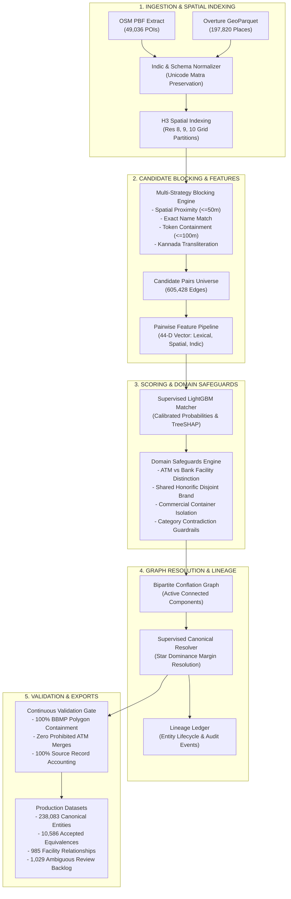

# India-Specific POI Conflation

[](#12-testing)
[](#10-installation-and-setup)
[](#10-installation-and-setup)
[](#7-dataset-and-study-area)

An industrial-grade, reproducible entity resolution and conflation system designed to reconcile overlapping, incomplete, and schema-divergent Point of Interest (POI) records between **OpenStreetMap (OSM)** and **Overture Maps Places**.

Tailored specifically for the dense urban fabric of Indian metropolitan areas, the pipeline addresses high-density commercial clusters, multilingual Indic scripts (Kannada and English), phonetic and transliteration drift, localized honorific abbreviations, and collocated facility relationships (such as standalone ATMs operating within bank branches or retail tenants within commercial complexes).

---

## 1. Project Overview

Entity resolution (record linkage) across open geospatial initiatives is critical for building trustworthy map layers. In Indian urban environments, conventional distance-and-string heuristics break down due to extreme physical proximity of distinct businesses, variable address formats, and cross-script variations.

This project delivers an end-to-end, production-tested conflation engine for the **Bruhat Bengaluru Mahanagara Palike (BBMP)** municipal boundary in Karnataka, India. The system scales across **246,856 source POIs** and **605,428 candidate edges**, employing a multi-strategy candidate blocking pipeline, a 44-dimensional pairwise feature vector, supervised gradient-boosted decision trees, deterministic domain safeguards, and a bipartite graph canonical resolver that prevents transitive cluster over-merging.

---

## 2. Problem Statement

Reconciling OpenStreetMap and Overture Maps data in India presents four unique domain challenges:

1. **Extreme Spatial Clustering:** In high-density commercial corridors (e.g., Chickpet, Commercial Street, Koramangala), dozens of independent establishments operate within 15 meters of each other across multiple vertical floors. Spatial proximity alone cannot confirm entity equivalence.
2. **Linguistic Divide & Script Disparity:** While OSM contributors extensively tag vernacular names in native Kannada script (12.67% of BBMP POIs), Overture Places is predominantly English (only 0.20% Kannada script). Conflation requires phonetic normalization and ISO 15919 transliteration to bridge script boundaries.
3. **Honorific & Name Variations:** Indian commercial naming commonly includes honorific prefixes (*Sri*, *Shree*, *St.*, *Dr.*) and corporate suffixes (*Pvt Ltd*, *Enterprises*, *Bhavan*). Two entities sharing an honorific (*Sri Raghavendra Stores* vs. *Sri Manjunatha Bakery*) are distinct businesses despite high token overlap.
4. **Hierarchical & Collocated Relationships:** Many nearby POI pairs do not represent duplicate records but rather functional relationships:
   - Standalone ATMs located inside or adjacent to bank branches.
   - Retail shops and restaurants situated inside shopping malls, tech parks, or hospital campuses.
   Merging these into single entities corrupts geographic reality.

---

## 3. Project Objectives

- **High-Reduction Candidate Generation:** Reduce the theoretical Cartesian search space ($49,036 \times 197,820 \approx 9.7 \times 10^9$ pairs) by over 99.99% while maximizing true match recall.
- **Multilingual Indic Feature Engineering:** Extract 44 pairwise similarity dimensions capturing metric spatial distances, character n-grams, token containment, category compatibility, and Kannada transliteration.
- **Explainable Supervised Matching:** Deploy calibrated LightGBM models with native TreeSHAP feature attributions and deterministic rule baselines.
- **Safe Graph-Based Entity Resolution:** Construct a bipartite conflation graph and apply star dominance margin resolution to isolate clusters, eliminate transitive over-merging, and classify non-equivalence relationships.
- **Production Pipeline & Continuous Validation:** Provide single-entry CLI orchestration with versioned source delta detection, SHA-256 normalized content hashing, persistent entity lineage, and continuous boundary validation.

---

## 4. System Architecture

The following diagram illustrates the complete conflation execution flow:



---

## 5. Technical Methodology

### 5.1 Ingestion, Schema Normalization & H3 Indexing
- **OSM Extraction:** High-throughput spatial polygon slicing via Geofabrik extracts and PyOsmium.
- **Overture Streaming:** Vectorized bounding-box predicate pushdown on AWS S3 GeoParquet partitions via DuckDB `httpfs`.
- **Schema Mapping:** Unification of diverse source taxonomies into a strongly typed PyArrow schema with 10 canonical domains: `sustenance`, `retail`, `services`, `healthcare`, `education`, `civic_religious`, `hospitality`, `transport`, `entertainment`, `commercial_office`.
- **H3 Indexing:** Concurrent discrete global grid partitioning at resolutions 8 (~461m), 9 (~174m), and 10 (~66m) for hierarchical spatial queries.

### 5.2 Multi-Strategy Candidate Generation
To prevent Cartesian explosion without sacrificing recall, the system unions four orthogonal blocking strategies:
1. **Spatial Proximity:** Distance $\le 50$ meters via metric grid cell binning ($200\text{m} \times 200\text{m}$) and 9-neighbor offset equi-joins.
2. **Exact Normalized Name Match:** Identical canonical names up to 500 meters.
3. **Distinctive Token Containment:** Core brand token intersection for records separated by $\le 100$ meters.
4. **Multilingual Transliteration:** Kannada script transliterated via ISO 15919 Sanscript matching English names $\le 100$ meters.
*Result:* Reduces 9.7 billion potential pairs to **605,428 candidate edges** (99.99376% reduction ratio).

### 5.3 Pairwise Feature Engineering
A 44-dimensional feature vector is extracted in streaming Parquet batches:
- **Lexical Similarities:** Levenshtein ratio, token sort ratio, token set ratio, partial ratio, Jaro-Winkler distance, and character n-gram overlaps ($n=2, 3, 4$).
- **Phonetic & Indic Metrics:** Double Metaphone alignments, Soundex codes, and Kannada script transliteration overlap.
- **Spatial Metrics:** Haversine distance, UTM Zone 43N projected Euclidean distance, coordinate deltas ($\Delta x, \Delta y$), and H3 cell equality flags.
- **Categorical & Contextual:** 4-tier category compatibility matrix scores and address token overlaps.

### 5.4 Supervised Matching & Explainability
- **Gradient-Boosted Decision Trees:** LightGBM classifier optimized for high precision, with Random Forest fallback.
- **Attribution:** Native TreeSHAP computation explaining positive and negative feature contributions for every edge.
- **Decision Bands:** Calibrated probabilities partitioned into `MATCH` ($p \ge 0.55$), `UNCERTAIN` ($0.30 \le p < 0.55$), and `NON_MATCH` ($p < 0.30$).

### 5.5 Domain Safeguards
Raw machine learning predictions are gated by deterministic domain safeguards:
- `ATM_VS_BANK_FACILITY_DISTINCTION`: Prevents standalone ATMs from fusing into parent bank branches; routes them to non-equivalence facility relationships.
- `SHARED_HONORIFIC_DISJOINT_BRAND`: Intercepts candidate pairs sharing common prefixes (*Sri*, *Dr.*, *Hotel*) when distinctive brand cores are disjoint, routing them to human review.
- `PARENT_CHILD_CONTAINER`: Identifies shops and clinics situated within larger malls, IT parks, or hospitals.
- `SAME_BRAND_DIFFERENT_BRANCH`: Rejects pairs sharing brand names but containing conflicting explicit locality markers (*Indiranagar* vs *Jayanagar*).

### 5.6 Bipartite Graph Conflation & Canonical Resolution
Candidate edges form an undirected bipartite graph $G = (V_{\text{osm}}, V_{\text{ov}}, E)$.
- **Star Dominance Margin Resolution:** For 1-to-many and many-to-many conflict hubs, the top-scoring edge is accepted only if its margin over competing edges exceeds $\delta \ge 0.15$; otherwise, the hub is preserved as singletons and routed to human review.
- **Canonical Identity:** Resolved entities receive deterministic UUIDv5 identifiers generated from sorted constituent source record IDs.

### 5.7 Delta Ingestion & Continuous Validation
- **Idempotent Ingestion:** Source record changes are detected via SHA-256 normalized content hashing (`ADDED`, `MODIFIED`, `DELETED`, `UNCHANGED`).
- **Lineage Ledger:** All canonical lifecycle events (`ENTITY_CREATED`, `ENTITY_UPDATED`, `ENTITY_MERGED`, `ENTITY_SPLIT`, `ENTITY_UNCHANGED`) are persisted to Parquet.
- **Continuous Validation:** Automated validation gate verifies 7 invariants including true point-in-polygon containment against the official BBMP boundary polygon.

---

## 6. Key Engineering Features

- **Apple Silicon Optimized:** Vectorized DuckDB SQL and streaming chunked inference (50,000-pair batches) consuming under **515 MB peak RSS** on an 8 GB unified memory machine.
- **Failure Isolation:** Atomic directory promotions (`staging/` $\rightarrow$ `production/`) ensure failed runs leave production untouched.
- **Multi-Signal Review Prioritization:** A 100-point scoring algorithm prioritizes the 2,842-pair review backlog into actionable tiers (`P1_CRITICAL` through `P4_LOW`).
- **6-Tier Provenance Taxonomy:** Isolates gold human consensus annotations from AI-adopted pilot labels.

---

## 7. Dataset and Study Area

- **Administrative Boundary:** Bruhat Bengaluru Mahanagara Palike (BBMP), Karnataka, India (OSM Relation `7902476`, `admin_level=7`).
- **Bounding Box:** `[77.4598797, 12.8334905, 77.7840639, 13.1426196]`.
- **Source Counts:**
  - OpenStreetMap: **49,036 POIs**
  - Overture Maps Places: **197,820 Places**
  - Total Source Inventory: **246,856 records**
- **Candidate Edges:** **605,428 pairs**
- **Data Licensing:**
  - OSM data is licensed under the [Open Database License 1.0 (ODbL)](https://opendatacommons.org/licenses/odbl/).
  - Overture Maps data is licensed under the [CDLA Permissive v2.0](https://cdla.dev/permissive-2-0/).

---

## 8. Results and Evaluation

### 8.1 Conflation Inventory Accounting

| Conflation Edge Disposition | Edge Count | Percent of Universe | Operational Outcome |
| :--- | :---: | :---: | :--- |
| **`REJECTED`** | **592,828** | 97.919% | Pruned non-matches |
| **`ACCEPTED_EQUIVALENCE`** | **10,586** | 1.749% | Merged into canonical entities |
| **`PARENT_CHILD`** | **985** | 0.163% | Preserved as facility relationships |
| **`REVIEW`** | **1,029** | 0.170% | Routed to human review backlog |
| **Total Candidate Universe** | **605,428** | **100.000%** | **100% reconciled accounting** |

- **Canonical Entities Generated:** **238,083 entities** (8,773 cross-source equivalences + 229,310 preserved singletons).
- **Boundary Containment:** **238,083 / 238,083 entities inside BBMP polygon (100.00%)**.
- **ATM-to-Bank Merges:** **0** prohibited cross-merges.

### 8.2 Evaluation Performance Across Benchmark Views

We evaluate the system across distinct benchmark views with decoupled selective coverage:

| System / Model | Evaluation View | Binary ($N$) | Precision | Recall | $F_1$ Score | Coverage |
| :--- | :--- | :---: | :---: | :---: | :---: | :---: |
| **Rule Baseline V1** | Gold Human ($N=51$) | 49 | 1.0000 | 0.8864 | 0.9398 | 79.59% |
| **Rule Baseline V2** | Gold Human ($N=51$) | 49 | 1.0000 | 0.9091 | 0.9524 | 81.63% |
| **Supervised LightGBM** | Gold Human ($N=51$) | 49 | 1.0000 | **1.0000** | **1.0000** | 89.80% |
| **Production Pipeline** | Gold Human ($N=51$) | 49 | **1.0000** | 0.9773 | 0.9885 | 87.76% |
| **Production Pipeline** | Consolidated Operational | 90 | **1.0000** | 0.9740 | 0.9868 | 83.33% |
| **Production Pipeline** | Held-Out Test Partition | **18** | **1.0000** | **1.0000** | **1.0000** | 83.33% |
| **Supervised LightGBM (Raw)**| Challenge Difficulty Set | 13 | 0.5000 | 1.0000 | 0.6667 | 100.00% |
| **Production Pipeline (Safeguards)**| Challenge Difficulty Set | 13 | **1.0000** | 0.7500 | **0.8571** | 76.92% |

> **Scientific Disclosure on Sample Bimodality:** The held-out test partition contains only 18 binary labeled pairs. The measured $F_1 = 1.0000$ reflects test set bimodality (positives have near-identical names; negatives have disjoint names) and is **not extrapolated to the general candidate population**.

### 8.3 Metric Spatial Distances
- **Accepted Equivalences:** Median distance is **13.72 meters** (75th percentile: 22.84m, 90th percentile: 36.22m, 99th percentile: 48.77m).
- **Facility Relationships:** Median distance is **18.45 meters**.
- **Ambiguous Review Backlog:** Median distance is **31.10 meters**, directly capturing the transitional boundary between identical entities and parcel neighbors.

---

## 9. Repository Structure

```
India_Specific_POI_Conflation/
├── configs/                             # Configuration files and spatial boundaries
│   ├── bbmp_boundary.geojson            # Official municipal boundary polygon
│   ├── conflation_config.yaml           # Pipeline parameter configurations
│   └── supervised_matching_config.yaml  # Model hyperparameters & feature lists
├── data/                                # Datasets (managed via .gitignore)
│   ├── raw/                             # Raw OSM PBF and Overture GeoParquet
│   └── processed/                       # Canonical entities, predictions, queues
├── models/                              # Trained model artifacts & metadata
│   ├── supervised_poi_matcher_v1.joblib # LightGBM gradient-boosted classifier
│   └── supervised_poi_matcher_v1_metadata.json
├── reports/                             # Technical reports, audits & figures
│   ├── figures/                         # High-resolution publication figures
│   ├── final_architecture_audit.md      # Architecture & subsystem dependency report
│   ├── final_system_validation.md       # Complete functional validation report
│   ├── final_cleanup_summary.md         # Final repository cleanup audit
│   └── m18_matching_quality_report.md   # Multi-system quality evaluation report
├── scripts/                             # CLI execution utilities & batch jobs
│   ├── evaluate_conflation_quality.py   # Cross-system quality evaluation runner
│   ├── prioritize_review_queue.py       # 100-point review queue prioritization
│   ├── run_geospatial_intelligence.py   # Distance distributions & figure generator
│   └── run_indic_language_analysis.py   # Kannada script transliteration analyzer
├── src/poi_conflation/                  # Core production package
│   ├── acquisition/                     # OSM extract parsing & Overture streaming
│   ├── analysis/                        # Geospatial & Indic language analyzers
│   ├── benchmark/                       # Provenance taxonomy & evaluation views
│   ├── blocking/                        # Multi-strategy candidate generation
│   ├── delta/                           # Snapshot content hashing & delta detection
│   ├── features/                        # 44-D pairwise feature extraction pipeline
│   ├── graph/                           # Bipartite graph, safeguards, and resolver
│   ├── indexing/                        # H3 multi-resolution spatial indexing
│   ├── lineage/                         # Persistent entity lifecycle ledger
│   ├── matching/                        # Rule engines, LightGBM, review prioritizer
│   ├── pipeline/                        # Orchestrator, CLI, atomic staging
│   ├── schema/                          # Canonical schema definitions
│   └── validation/                      # Continuous conflation integrity gate
├── tests/                               # Comprehensive automated test suite
├── PROJECT_STATE.md                     # Detailed milestone ledger & architecture decisions
├── pyproject.toml                       # Python package configuration
└── requirements-lock.txt                # Fully pinned reproducible dependencies
```

---

## 10. Installation and Setup

### Prerequisites
- macOS (Apple Silicon / Intel) or Linux (Ubuntu 22.04+).
- Python 3.12 (recommended: managed via `pyenv` or Homebrew).
- 8 GB RAM minimum.

### Setup Instructions

1. **Clone the repository:**
   ```bash
   git clone https://github.com/sushantydv01/India_Specific_POI_Conflation.git
   cd India_Specific_POI_Conflation
   ```

2. **Create and activate virtual environment:**
   ```bash
   python3.12 -m venv .venv
   source .venv/bin/activate
   ```

3. **Install pinned dependencies:**
   ```bash
   pip install --upgrade pip
   pip install -r requirements-lock.txt
   ```

4. **Verify installation:**
   ```bash
   python -m src.poi_conflation.pipeline --help
   ```

---

## 11. Usage

### 1. Validate Production Outputs
Verify integrity, source accounting, coordinate bounds, and boundary polygon containment:
```bash
python -m src.poi_conflation.pipeline validate
```

### 2. Run Quality Evaluation
Evaluate Rule Baseline V1, Rule Baseline V2, LightGBM, and Production Pipeline across all benchmark views:
```bash
python scripts/evaluate_conflation_quality.py
```

### 3. Run Geospatial Intelligence
Compute metric distance distributions and generate publication figures in `reports/figures/`:
```bash
python scripts/run_geospatial_intelligence.py
```

### 4. Run Indic Language & Transliteration Analysis
Analyze vernacular Kannada representation and export review expansion queues:
```bash
python scripts/run_indic_language_analysis.py
```

### 5. Prioritize Ambiguous Review Backlog
Rank 2,842 unresolved pairs into explainable tiers (`P1_CRITICAL` to `P4_LOW`):
```bash
python scripts/prioritize_review_queue.py
```

---

## 12. Testing

The repository contains an exhaustive automated test suite covering unit logic, graph algorithms, incremental mutations, failure recovery, spatial geometry, and safeguards.

Execute the full test suite via Pytest:
```bash
pytest tests/
```

**Verified Test Result:**
```
====================== 235 passed, 14 warnings in 19.81s =======================
```

---

## 13. Limitations and Future Work

1. **Ground-Truth Volume:** The repository relies on 51 pure human-reviewed pairs and 49 AI-adopted pilot labels. Future work will leverage the prioritized review queue to expand pure human consensus ground truth.
2. **Held-Out Test Bimodality:** The test set ($N=18$) exhibits clear bimodality between obvious matches and obvious non-matches. Future benchmarks require higher densities of subtle borderline pairs.
3. **Source Asymmetry in Kannada Data:** While OSM features 12.67% Kannada names, Overture has only 0.20%, placing the burden of transliteration recovery entirely on candidate blocking.
4. **Vertical Address Stacks:** High-density multi-story shopping malls with overlapping floor footprints remain challenging without explicit 3D floor level tags.

---

## 14. Data Licensing and Attribution

- **OpenStreetMap Data:** © [OpenStreetMap contributors](https://www.openstreetmap.org/copyright), distributed under the [Open Database License 1.0 (ODbL)](https://opendatacommons.org/licenses/odbl/). Conflated derivatives incorporating OSM data are subject to ODbL attribution and share-alike terms.
- **Overture Maps Data:** Courtesy of the [Overture Maps Foundation](https://overturemaps.org/), distributed under the [Community Data License Agreement – Permissive – Version 2.0 (CDLA Permissive v2.0)](https://cdla.dev/permissive-2-0/). Portions derived from OSM carry underlying ODbL attribution.
- **Data Compliance Boundary:** Raw and intermediate geospatial data remain strictly outside version control (managed via `.gitignore`). Benchmark annotations and evaluation outputs document upstream source provenance and respect licensing boundaries.

---

## 15. Author

**Sushant Yadav**  
GitHub: [@sushantydv01](https://github.com/sushantydv01)  
Repository: [India_Specific_POI_Conflation](https://github.com/sushantydv01/India_Specific_POI_Conflation)
