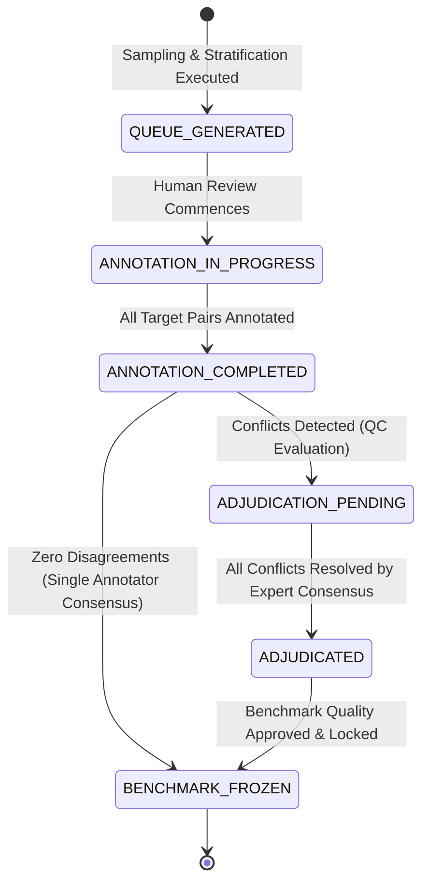

# POI Ground Truth Benchmark Lifecycle & Release Semantics

This document defines the formal lifecycle states, release versioning semantics, and governance criteria for the human-labelled ground truth benchmark in the **India-Specific POI Conflation** project.

---

## 1. Lifecycle State Machine

A ground truth benchmark is not a static artifact; it progresses through strict, verifiable lifecycle phases:



### Lifecycle Stage Definitions

| Lifecycle State | Criteria & Prerequisites | Allowed Operations |
| :--- | :--- | :--- |
| **`QUEUE_GENERATED`** (Current) | Stratified candidate sampling executed; queue CSV, pilot batch, and manifest generated. Zero human labels recorded. | Launch pilot review; assign annotators. Model training strictly prohibited. |
| **`ANNOTATION_IN_PROGRESS`** | Human annotator sessions active; partial annotations recorded in `annotations/`. | Incremental annotation; progress saving and resuming. |
| **`ANNOTATION_COMPLETED`** | Every pair in the target queue has received at least one human annotation. | Quality control evaluation; inter-annotator agreement computation. |
| **`ADJUDICATION_PENDING`** | Inter-annotator conflicts detected and queued in `adjudication_queue.csv`. | Consensus peer review; expert adjudication. |
| **`ADJUDICATED`** | All conflicts in `adjudication_queue.csv` resolved with documented rationale. | Final benchmark assembly. |
| **`BENCHMARK_FROZEN`** | Final benchmark verified, locked, and hashed. Read-only release. | Model evaluation, feature engineering benchmark, publication metrics. |

---

## 2. Release Governance Rules

1. **Never Declare `BENCHMARK_FROZEN` Prematurely:** A benchmark manifest must **never** be marked as frozen while annotations remain incomplete or unadjudicated.
2. **Current Repository State:** The benchmark manifest version is **v1.1.0** with lifecycle state:
   ```json
   {
     "benchmark_schema_version": "1.1.0",
     "lifecycle_state": "QUEUE_GENERATED",
     "is_frozen": false
   }
   ```
3. **Auditability:** Every lifecycle transition is recorded in `data/processed/benchmark/benchmark_metadata.json` with UTC timestamps, commit hashes, and file record counts.
