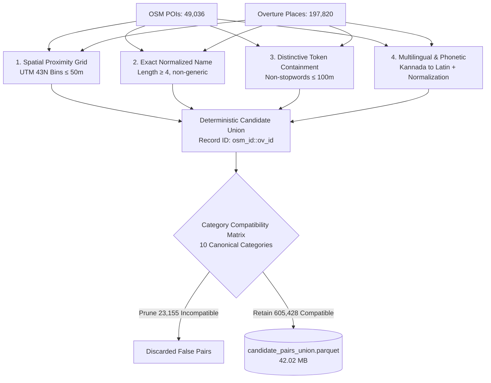

# Candidate Generation & Multi-Attribute Blocking Architecture

This document specifies the architecture, algorithmic design, and empirical performance of the candidate generation and multi-attribute blocking pipeline for the **India-Specific POI Conflation** project across Bruhat Bengaluru Mahanagara Palike (BBMP), Bengaluru, India.

---

## 1. Architectural Philosophy & Objectives

In cross-source POI entity resolution between OpenStreetMap (OSM) and Overture Maps Places, the primary goal of candidate generation is **high-recall filtering**:

$$\text{Theoretical Cartesian Pair Space} = N_{\text{OSM}} \times N_{\text{OVERTURE}} = 49{,}036 \times 197{,}820 \approx 9{,}700{,}301{,}520 \text{ pairs}$$

Evaluating nearly 10 billion pairs through computationally intensive matching models (string similarity, phonetic distance, transformer embeddings, probabilistic record linkage) is computationally intractable and memory-prohibitive on local workstation hardware (Apple M3, 8 GB RAM).

### Core Principles
1. **Recall Orientation:** Candidate generation acts strictly as an inclusive retrieval filter. A true match lost at this stage cannot be recovered by downstream classifiers.
2. **No Premature Classification:** Candidate generation **does not** assign MATCH or NON-MATCH labels. Candidate pairs are simply plausible co-referent hypotheses to be scored in downstream matching stages.
3. **No Unsubstantiated Recall Claims:** True recall, precision, and F1-score cannot be reported at the blocking stage because ground-truth labels do not yet exist. Instead, reduction ratio, candidate-to-entity cardinality, and provider coverage are tracked.
4. **Multi-Strategy Complementarity:** Spatial proximity alone is insufficient due to GPS drift, differing centroid definitions (building centroid vs. entrance node), and large physical complexes. Multiple orthogonal blocking strategies must be unioned to maximize recall while maintaining a manageable reduction ratio.

---

## 2. Multi-Strategy Blocking Design

To capture diverse match archetypes while minimizing false dismissals, four distinct blocking strategies are executed:



### Strategy 1: Metric Spatial Grid Blocking ($\le 50$m)
- **Mechanism:** Coordinates are projected to UTM Zone 43N (EPSG:32643). Space is partitioned into $200\text{m} \times 200\text{m}$ metric grid cells. Candidates are generated via spatial equi-joins across each cell and its 8 contiguous neighbors ($3 \times 3$ kernel).
- **Metric Distance Filter:** Euclidean metric distance $\sqrt{\Delta X^2 + \Delta Y^2} \le 50.0\text{ m}$.
- **Rationale:** Captures micro-spatial proximity where 87.57% of OSM entities find candidates.

### Strategy 2: Exact Normalized Name Blocking
- **Mechanism:** Equi-join on `name_normalized` where string length $\ge 4$ characters.
- **Generic Chain Guard:** Excludes broad national banking chains and uninformative generic terms (`state bank of india`, `icici bank`, `hdfc bank`, `atm`, `temple`, `church`, `mosque`) which would otherwise generate Cartesian explosion across the city.
- **Coverage Role:** Recovers cross-source entities that experienced spatial displacement up to $2{,}000\text{m}$ (e.g., tech park campuses, relocated offices, transit hubs).

### Strategy 3: Distinctive Token Containment ($\le 100$m)
- **Mechanism:** Extracts informative tokens of length $\ge 4$ characters after stripping Indian urban and commercial stopwords (`bangalore`, `bengaluru`, `road`, `cross`, `nagar`, `layout`, `pvt`, `ltd`, etc.).
- **Proximity Guard:** Constrained to candidates within $\le 100.0\text{ m}$.
- **Coverage Role:** Identifies legal vs. brand name variants (e.g., `Avalon` vs. `Avalon Technology And Services Private Limited`).

### Strategy 4: Multilingual & Phonetic Blocking
- **Mechanism:** Converts native Kannada script names in OSM to Romanized Latin via the Sanscript ISO 15919 transliteration engine, followed by Indian English phonetic normalization (`udapi` $\rightarrow$ `udupi`, `shree`/`shri` $\rightarrow$ `sri`, `bhavana` $\rightarrow$ `bhavan`, `sagara` $\rightarrow$ `sagar`, `laxmi` $\rightarrow$ `lakshmi`).
- **Coverage Role:** Bridges the digital divide between local-language vernacular mapping in OSM and English-dominated commercial directory data in Overture.

---

## 3. Category Compatibility Blocking Matrix

Not all spatially proximate POIs are plausible matches. Co-located but semantically disjoint entities (e.g., an ATM next to a bakery, a clinic inside a residential area) clutter the candidate space.

The pipeline applies a **4-tier Category Compatibility Matrix** over the 10 canonical categories:

| Compatibility Level | Definition | Action in Pipeline | Examples |
| :--- | :--- | :--- | :--- |
| **STRONGLY_COMPATIBLE** | Identical canonical category | Retained with highest prior confidence | Sustenance $\leftrightarrow$ Sustenance, Healthcare $\leftrightarrow$ Healthcare |
| **POTENTIALLY_COMPATIBLE** | Semantically plausible adjacencies | Retained for feature extraction | Sustenance $\leftrightarrow$ Accommodation (Hotel & Restaurant), Retail $\leftrightarrow$ Sustenance (Cafe in Bookstore) |
| **COMPATIBLE_UNKNOWN** | One or both categories unclassified | Retained to preserve recall | `other_unclassified` $\leftrightarrow$ Any Category |
| **INCOMPATIBLE** | Strictly mutually exclusive domains | **Pruned immediately** | Healthcare $\leftrightarrow$ Sustenance, Education $\leftrightarrow$ Automotive |

### Category Pruning Impact
- **Incompatible Pairs Pruned:** **23,155 pairs** eliminated prior to output generation.
- **Zero Loss to Known Adjacencies:** All cross-domain retail/food, hospitality/sustenance, and public service combinations are preserved.

---

## 4. Candidate Union Schema Specification

The final candidate pool is materialized to Apache Parquet with Zstandard compression:

* **File:** `data/processed/candidate_pairs/candidate_pairs_union.parquet`
* **File Size:** **42.02 MB**
* **Total Candidate Pairs:** **605,428 pairs**
* **Deterministic Identifier:** `candidate_pair_id` formatted as `<osm_source_record_id>::<overture_source_record_id>` (e.g., `node/11393299745::ac10dd85-2dc9-4345-a145-a45c5ed9d241`).

### Schema Definition
```text
candidate_pair_id              : string (Deterministic primary key)
osm_id                         : string (OSM canonical POI ID, UUIDv5)
osm_source_id                  : string (Original OSM record ID, e.g. "node/123")
osm_name                       : string (Source normalized name)
osm_category                   : string (Canonical normalized category)
ov_id                          : string (Overture canonical POI ID, UUIDv5)
ov_source_id                   : string (Original Overture GID, UUIDv4)
ov_name                        : string (Source normalized name)
ov_category                    : string (Canonical normalized category)
distance_meters                : double (Metric Euclidean distance in UTM 43N)
exact_name_match               : boolean (True if normalized names match identically)
name_containment               : boolean (True if one name contains the other)
category_compatibility         : string (STRONGLY_COMPATIBLE / POTENTIALLY_COMPATIBLE / COMPATIBLE_UNKNOWN)
blocking_strategies            : string[] (List of strategies that generated this pair)
strategies_provenance          : string (Joined provenance string e.g. "spatial_50m+exact_name")
```

---

## 5. Empirical Performance & Metrics

Across the Bruhat Bengaluru Mahanagara Palike universe:

$$\text{Reduction Ratio} = 1 - \frac{|C|}{N_{\text{OSM}} \times N_{\text{OVERTURE}}} = 1 - \frac{605{,}428}{9{,}700{,}301{,}520} = \mathbf{99.99376\%}$$

| Metric | Measured Value | Significance |
| :--- | :--- | :--- |
| **Candidate Pairs** | **605,428** | Scalable search space for ML scoring |
| **Unique OSM Records Reached** | **43,075 (87.84%)** | +137 records recovered over spatial alone |
| **Unique Overture Records Reached**| **113,959 (57.61%)** | High coverage of commercial universe |
| **Unmatched OSM Records** | **5,961 (12.16%)** | Peripheral / rural boundary nodes with no Overture presence |
| **Mean Candidates / OSM** | **14.06** | Tractable candidate density |
| **Median Candidates / OSM** | **9.0** | Robust against extreme skew |
| **Max Candidates / OSM** | **969** | Dense commercial hubs (Chickpet / SP Road) |
| **Pipeline Wall-Clock Runtime** | **5.03 seconds** | Sub-second DuckDB grid queries on Apple M3 |

---

## 6. Next Steps: Downstream Scoring (Milestone 5)

The generated candidate pairs provide the foundation for Milestone 5:
1. Feature extraction over candidate pairs (Jaro-Winkler, Levenshtein, Token Sort Ratio, geographic displacement vectors, category similarity matrix).
2. Human-in-the-loop active learning / active sampling for ground-truth annotation.
3. Supervised classification and probabilistic entity resolution.
