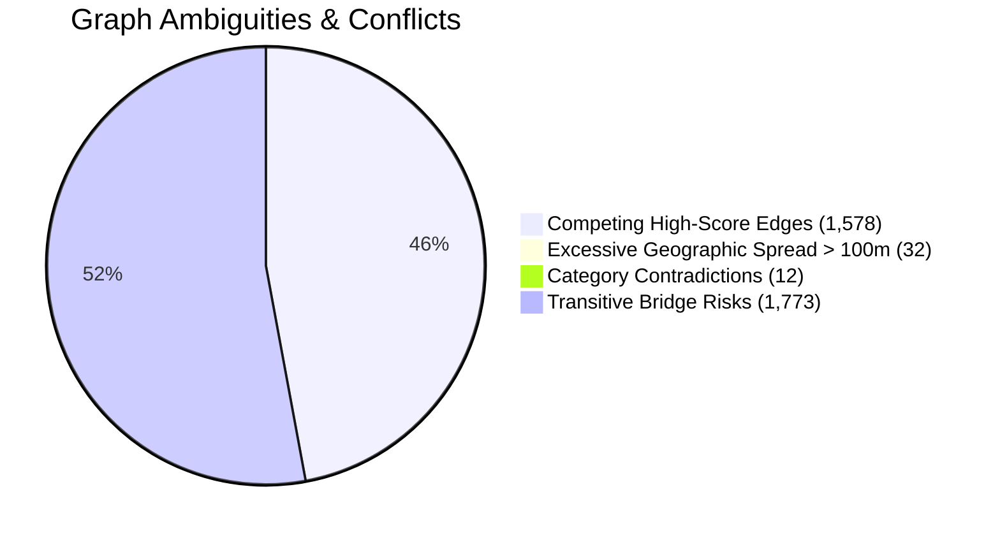

# Conservative Canonical POI Entity Resolution & Conflict Analysis

## Executive Summary

Milestone 10 introduces a conservative canonical entity resolution layer and explicit ambiguity detection engine (`canonical_resolution_v1`).

The system resolves bipartite conflation graph components into canonical Point of Interest entities while adhering to strict data engineering principles:
1. **Zero Record Loss:** All 246,856 source POIs (49,036 OSM and 197,820 Overture) are explicitly accounted for.
2. **Conservative Merging:** No entities are merged without strong, unambiguous evidence. Ambiguous components are preserved in an unmerged state.
3. **Parent-Child Separation:** Container relationships (e.g. shopping malls containing retail stores, hospitals containing pharmacies) are isolated from identity equivalence.
4. **Prioritized Review Queue:** Structural conflicts and competing candidate edges are ranked and routed for active human adjudication.

---

## 1. Resolution Decision Distribution

Across the entire BBMP study area, the resolution pipeline resolved the 246,856 source records into **242,243 canonical POI entities**:

| Resolution Decision | Output Entities | Contributing Source POIs | Conflation Semantics |
| :--- | :---: | :---: | :--- |
| **`RESOLVED_EQUIVALENCE`** | **4,613** | 9,226 (4,613 OSM + 4,613 Overture) | High-confidence $1:1$ or disambiguated star matches. Merged into a unified entity with joint provenance. |
| **`PARENT_CHILD`** | **104** | 104 (52 OSM + 52 Overture) | Commercial container vs. internal establishment (e.g. mall anchor vs. store). Maintained as distinct entities linked via `parent_entity_id`. |
| **`DISAMBIGUATED_SINGLETON`** | **217,531** | 217,531 (35,009 OSM + 182,103 Overture + 419 runners-up) | Valid single-source entities with no active match counterpart. Preserved with 100% attribute fidelity. |
| **`UNRESOLVED_AMBIGUOUS`** | **19,995** | 19,995 | Complex multi-tenant clusters or close competing candidates quarantined from automatic merging. |
| **Total Canonical Entities** | **242,243** | **246,856** | **Net Reduction: 4,613 entities conflated** |

---

## 2. Canonical POI Schema & Identifier Generation

Every canonical entity receives a deterministic, collision-free **UUIDv5** identifier generated via:

$$\text{UUIDv5}(\text{NAMESPACE\_DNS}, \text{"osm:"} + \text{sorted}(OSM\_IDs) + \text{"\|ov:"} + \text{sorted}(OV\_IDs))$$

This ensures that canonical IDs are completely reproducible and invariant to row processing order.

### Canonical Record Fields
- `canonical_entity_id`: Deterministic UUIDv5 string.
- `resolution_decision`: One of `RESOLVED_EQUIVALENCE`, `PARENT_CHILD`, `DISAMBIGUATED_SINGLETON`, `UNRESOLVED_AMBIGUOUS`.
- `resolution_policy`: `"canonical_resolution_v1"`.
- `contributing_osm_ids`: List of constituent OpenStreetMap source IDs.
- `contributing_ov_ids`: List of constituent Overture Places GERS IDs.
- `primary_name`: Normalized canonical label (prefers OSM vernacular with specific fallback).
- `source_names`: Complete dictionary of original source names by provider.
- `primary_category`: Specific canonical category (prefers domain taxonomy over generic `'other'`).
- `source_categories`: Complete dictionary of original provider categories.
- `latitude`, `longitude`, `utm_x`, `utm_y`: Planar coordinates (UTM Zone 43N).
- `cluster_id` and `cluster_pattern`: Provenance link to graph cluster.
- `parent_entity_id`: For `PARENT_CHILD` records, points to the container entity.
- `resolution_evidence`: Structured bulleted justification.
- `conflict_notes`: Specific warnings if held in `UNRESOLVED_AMBIGUOUS`.

---

## 3. Ambiguity & Conflict Analysis

The conflict analyzer ([src/poi_conflation/graph/ambiguity_analyzer.py](file:///Users/sushantydv01/Desktop/India_Specific_POI_Conflation/src/poi_conflation/graph/ambiguity_analyzer.py)) identified **1,658 ambiguous clusters** across four primary failure modes:



1. **Competing High-Score Edges (1,578 clusters):**
   A node is linked to two or more active candidates whose scores differ by $|\Delta S| \le 0.05$. Arbitrarily selecting the top edge would risk misidentifying adjacent commercial establishments.
2. **Category Contradictions (12 clusters):**
   Active edges connect entities with disjoint taxonomy pairings (e.g. *ICICI Bank* [financial] vs. *Vasan Eye Care* [healthcare], or *Villa Lavelle* [hotel] vs. *Dental Lavelle* [clinic]).
3. **Excessive Geographic Spread (32 clusters):**
   Active components spanning $> 100\,\text{m}$ (up to $284.3\,\text{m}$). These represent chain franchises (*Apollo Pharmacy*, *Subway*, *HDFC Bank ATM*) or dense commercial avenues where weak edges chained together distinct locations.
4. **Transitive Bridge Risks (1,773 instances):**
   Weak edges ($S \in [0.55, 0.65]$) acting as bridges between otherwise distinct subgraphs. The conservative resolver refused to merge these, preventing runaway transitive over-merging.

---

## 4. Human Review Prioritization Queue

The pipeline synthesized **1,033 ranked cases** into [reports/review_prioritization_queue.json](file:///Users/sushantydv01/Desktop/India_Specific_POI_Conflation/reports/review_prioritization_queue.json):

| Priority Rank | Conflict Type | Queued Items | Human Review Justification |
| :---: | :--- | :---: | :--- |
| **Tier 1 (Highest)** | `CATEGORY_CONTRADICTION` | **12** | High-scoring edge ($S \ge 0.60$) between contradictory categories. High likelihood of collocated different businesses or complex dual-purpose tagging. |
| **Tier 2** | `COMPETING_HIGH_SCORE_EDGES` | **989** | Competitors with $|\Delta S| \le 0.05$. Resolving these edges directly determines the canonical identity of the POI. |
| **Tier 3** | `EXCESSIVE_GEOGRAPHIC_SPREAD` | **32** | Clusters spanning $> 100\,\text{m}$ in urban space. Review confirms whether they are multi-building complexes or distinct branch locations. |
| **Total Queued** | | **1,033** | **Structured queue with pair IDs, source names, categories, and exact scores** |

### Representative Prioritized Case (Tier 1: Category Contradiction)
```json
{
  "item_id": "REV-00002",
  "priority_rank": 1,
  "ambiguity_type": "CATEGORY_CONTRADICTION",
  "cluster_id": "CLUSTER-004694",
  "pair_id": "node/1463555171::85732c67-24ee-4126-9b61-d33f4defee61",
  "osm_name": "ICICI Bank",
  "ov_name": "Vasan Eye Care - RR Nagar",
  "osm_category": "financial",
  "ov_category": "healthcare",
  "score": 0.98,
  "distance_meters": 44.73,
  "reason_for_prioritization": "Incompatible categories (financial, healthcare, other) in cluster with score 0.98"
}
```

---

## 5. Execution Summary & Artifact Locations

The resolution script ([scripts/resolve_canonical_entities.py](file:///Users/sushantydv01/Desktop/India_Specific_POI_Conflation/scripts/resolve_canonical_entities.py)) executed in **8.71 seconds** with peak memory of **1,237.89 MB RSS**.

Generated artifacts:
- **Canonical Summary:** [reports/canonical_entities_summary.json](file:///Users/sushantydv01/Desktop/India_Specific_POI_Conflation/reports/canonical_entities_summary.json)
- **Ambiguity Diagnostics:** [reports/graph_ambiguity_report.json](file:///Users/sushantydv01/Desktop/India_Specific_POI_Conflation/reports/graph_ambiguity_report.json)
- **Prioritized Review Queue:** [reports/review_prioritization_queue.json](file:///Users/sushantydv01/Desktop/India_Specific_POI_Conflation/reports/review_prioritization_queue.json)
- **Representative Samples:** [reports/canonical_entities_sample.json](file:///Users/sushantydv01/Desktop/India_Specific_POI_Conflation/reports/canonical_entities_sample.json)
