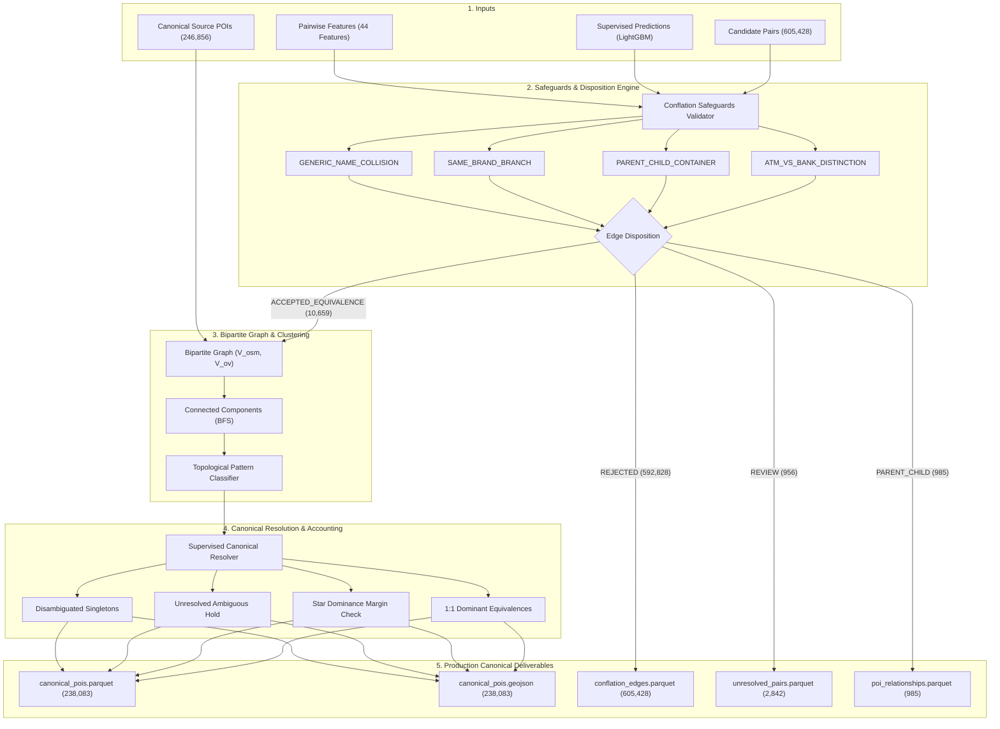

# Bipartite Graph Conflation & Canonical POI Entity Resolution

**Document Purpose:** Architectural and methodological guide for Milestone 16: integrating supervised POI matching into a bipartite conflation graph, applying domain safeguards, resolving conservative canonical entities, and exporting production datasets.

---

## 1. Architectural Overview & Design Philosophy

Conflating Points of Interest across disparate geospatial sources (such as OpenStreetMap and Overture Maps Places) cannot be treated solely as a series of independent pairwise binary classification decisions. In high-density urban environments like Bruhat Bengaluru Mahanagara Palike (BBMP), multiple real-world businesses operate in close physical proximity, share commercial parent containers, or present ambiguous branding (e.g. standalone ATM kiosks colocated with bank branches).

A core engineering principle guides Milestone 16:
> **A pairwise MATCH prediction is a candidate equivalence hypothesis, not an unconditional merge mandate.**

Merging two source records permanently fuses their entity identities. If false-positive candidates are blindly collapsed, entity identity is irreversibly corrupted. Milestone 16 interposes a bipartite graph layer and domain safeguards between supervised machine learning predictions and canonical entity generation, ensuring that entity fusion occurs only when topological and domain-specific evidence permits.



---

## 2. Mandatory Domain-Specific Safeguards

In Milestone 15.1, an independent evaluation audit identified vulnerability archetypes in the universe predictions of the supervised model. Milestone 16 implements explicit domain safeguards in `src/poi_conflation/graph/safeguards.py` to intercept these failure modes before graph edge acceptance.

### 2.1 ATM vs. Bank Branch (`ATM_VS_BANK_FACILITY_DISTINCTION`)
- **The Problem:** Bank branches and standalone ATM kiosks frequently share brand tokens (e.g. `HDFC Bank` vs `HDFC Bank ATM`) and operate within 5 to 50 meters of one another. The supervised model, lacking negative training examples for ATM-branch pairs, scored these with high match scores ($p \approx 0.65 - 0.99$).
- **The Safeguard:** Detects ATM-specific keywords (`atm`, `cdm`, `cash point`, `cash deposit`, `automated teller machine`) and taxonomy tags. When one record is an ATM and the other is a full banking institution, equivalence is **strictly prohibited**.
- **Resolution:** If the pair shares brand tokens within 100 meters, it is classified as a `FACILITY_ATM` relationship under `PARENT_CHILD`, linking the ATM as a subordinate facility of the bank branch without collapsing them into one entity.
- **Empirical Impact:** Intercepted **365** candidate edges, routing 362 pairs into `poi_relationships.parquet`.

### 2.2 Parent-Child Commercial Containers (`PARENT_CHILD_CONTAINER`)
- **The Problem:** Commercial containers (e.g. shopping malls, IT business parks, corporate campuses, hospital compounds, airports) host numerous distinct internal retail and dining tenants. High token containment and spatial proximity can trick pairwise models into predicting merges.
- **The Safeguard:** Evaluates container descriptors (`mall`, `complex`, `plaza`, `center`, `tech park`, `hospital`, `campus`, `marketcity`) against internal facility and tenant descriptors (`cafeteria`, `canteen`, `food court`, `pharmacy`, `clinic`, `store`, `shop`, `library`).
- **Resolution:** Prohibits equivalence merge. Classifies the edge as `PARENT_CHILD` or `CAMPUS_FACILITY` in `poi_relationships.parquet`.
- **Empirical Impact:** Intercepted **623** container pairs (e.g. `Phoenix Marketcity` vs `Zara`, `Manyata Tech Park` vs `Subway`).

### 2.3 Same-Brand Different Branches (`SAME_BRAND_DIFFERENT_BRANCH`)
- **The Problem:** National chains (e.g. `Domino's Pizza`, `State Bank of India`, `Nandhini Restaurant`, `Apollo Pharmacy`) operate multiple branches across Bengaluru.
- **The Safeguard:** Scans for standardized urban locality qualifiers (`Koramangala`, `Indiranagar`, `Whitefield`, `Jayanagar`, `HSR Layout`) and block/phase qualifiers (`4th Block`, `9th Block`). When brand names match but locality or phase tokens explicitly contradict, or when distance exceeds 40 meters without exact spatial coincidence, equivalence is **rejected**.
- **Resolution:** Hard rejection for equivalence. Preserves both records as distinct canonical singletons.

### 2.4 Generic Name Collisions (`GENERIC_NAME_COLLISION`)
- **The Problem:** Generic urban establishment descriptors (`Hotel`, `Restaurant`, `Medical Store`, `Bakery`, `Salon`, `Temple`, `Supermarket`) are highly frequent. Spatial proximity between two independent generic establishments does not prove identity.
- **The Safeguard:** When both records consist of generic words, or share a generic prefix but have completely disjoint distinctive brand tokens (e.g. `Hotel Sagar` vs `Hotel Green Orchid` at 34m), equivalence is **prohibited**.
- **Resolution:** Routed to `REVIEW` in `unresolved_pairs.parquet`.
- **Empirical Impact:** Intercepted **188** generic name collisions.

### 2.5 Category Incompatibility & Spatial Displacement
- **`CATEGORY_INCOMPATIBLE`:** Enforces the 4-tier category compatibility matrix. Cross-domain disjoint taxonomies (e.g. `healthcare` vs `sustenance`, `education` vs `financial`) are hard-rejected.
- **`EXCESSIVE_SPATIAL_SEPARATION`:** Hard-rejects candidate pairs with spatial separation $> 50$m without exact name match, or $> 80$m under all conditions (**382** edges rejected).
- **`MISSING_OR_EMPTY_NAME`:** Prohibits equivalence when either source record lacks a name (**82,107** edges rejected).

---

## 3. Graph Construction & Cluster Disambiguation

Edges that survive domain safeguards with disposition `ACCEPTED_EQUIVALENCE` are loaded into `BipartiteConflationGraph`. Connected components are discovered using breadth-first search (BFS).

### 3.1 Cluster Structural Patterns
In the Bengaluru candidate space, 10,659 accepted equivalence edges form **9,532 active equivalence clusters**:

| Cluster Pattern | Cluster Count | Resolution Policy |
| :--- | :-: | :--- |
| **`ONE_TO_ONE`** | **8,662** | Single OSM node paired with single Overture node. Resolved to `RESOLVED_EQUIVALENCE`. |
| **`ONE_TO_MANY`** | **219** | Star component (1 OSM node connected to $N$ Overture candidates). Resolved via dominance margin check. |
| **`MANY_TO_ONE`** | **101** | Star component ($N$ OSM candidates connected to 1 Overture node). Resolved via dominance margin check. |
| **`AMBIGUOUS_CLUSTER`** | **537** | Competing candidates with close scores. Held as `UNRESOLVED_AMBIGUOUS` without merging. |
| **`MANY_TO_MANY`** | **13** | Complex multi-node subgraph. Held as `UNRESOLVED_AMBIGUOUS` without merging. |

### 3.2 Star Disambiguation & Dominance Margin Check
In star clusters ($1:N$ or $N:1$), multiple records from one source compete for a single record in the other source. In a physical urban environment, 1 OSM record cannot simultaneously be identical to 2 distinct physical Overture establishments:
- Let $s_1$ be the highest candidate edge score, and $s_2$ be the runner-up edge score.
- Let $\Delta s = s_1 - s_2$ be the dominance margin.
- **Rule:** If $s_1 \ge 0.70$ and $\Delta s \ge 0.15$:
  - The winning pair $(u, v_1)$ is resolved as `RESOLVED_EQUIVALENCE`.
  - The subordinated runner-up nodes $v_2, \dots, v_n$ are preserved as distinct `DISAMBIGUATED_SINGLETON` canonical entities.
  - The runner-up edges are subordinated and exported to `unresolved_pairs.parquet`.
- **Ambiguity Fallback:** If $\Delta s < 0.15$:
  - Neither candidate is assumed correct. All constituent nodes are held as separate `UNRESOLVED_AMBIGUOUS` entities.
  - All competing edges are routed to `unresolved_pairs.parquet` for human adjudication.

---

## 4. Source Inventory Accounting & Invariants

Milestone 16 strictly enforces **100.00% source-record inventory accounting**:

$$\text{Total Accounted Source POIs} = N_{\text{osm, assigned}} + N_{\text{ov, assigned}} = 49,036 + 197,820 = 246,856$$

Every original source POI is mapped to **exactly one** canonical POI entity:

```
Canonical Entities (238,083 Total):
├── Multi-Source Equivalences (RESOLVED_EQUIVALENCE): 8,773 entities (8,773 OSM + 8,773 Overture = 17,546 source POIs)
├── Ambiguous Candidates (UNRESOLVED_AMBIGUOUS): 2,485 entities (single-source representations)
└── Disambiguated Singletons (DISAMBIGUATED_SINGLETON): 226,825 entities
    ├── OSM Singletons: 40,263 entities
    └── Overture Singletons: 189,047 entities
```

### Verified Accounting Checks:
1. **Zero Lost Records:** Accounted source count ($246,856$) == Canonical input universe ($246,856$).
2. **Zero Duplicate Inclusions:** No OSM node ID or Overture GID is assigned to more than one canonical entity.
3. **Collision-Free IDs:** Exactly 238,083 unique UUIDv5 identifiers generated from sorted source constituent IDs.
4. **Coordinate Integrity:** 100% of canonical entities fall within BBMP administrative bounds ($12.8 \le lat \le 13.2$, $77.4 \le lon \le 77.9$).

---

## 5. Canonical Attributes & Provenance Preservation

Canonical POI entities do not destroy or overwrite source attributes:
- **`canonical_entity_id`:** Stable, deterministic UUIDv5 in namespace `9a8bf37f-af65-5399-9fab-35bcd714c702`.
- **`primary_name`:** Selected deterministically: prefers non-empty, descriptive official names over abbreviations or generic tags.
- **`alternate_names`:** Retains secondary names, transliterations, and vernacular Kannada script strings (`name_kn`).
- **`primary_category`:** Retains specific canonical category over generic `other`.
- **`source_names` & `source_categories`:** JSON-serialized dictionary preserving original values per source partition (`OSM`, `OVERTURE`).
- **`source_coordinates`:** JSON dictionary recording the exact latitude and longitude contributed by each source record.

---

## 6. Output Artifacts Manifest

| Export Artifact Path | Format | Record Count | File Size | Description |
| :--- | :---: | :-: | :-: | :--- |
| `data/processed/canonical/canonical_pois.parquet` | Parquet (ZSTD) | 238,083 | 23 MB | Primary canonical entity inventory with full attributes and provenance. |
| `data/processed/canonical/canonical_pois.geojson` | GeoJSON (EPSG:4326) | 238,083 | 86 MB | GIS-ready FeatureCollection of resolved canonical POI points. |
| `data/processed/canonical/conflation_edges.parquet` | Parquet (ZSTD) | 605,428 | 31 MB | Complete candidate edge universe with final dispositions and reasons. |
| `data/processed/canonical/unresolved_pairs.parquet` | Parquet (ZSTD) | 2,842 | 219 KB | Prioritized review queue of uncertain, competing, and ambiguous pairs. |
| `data/processed/canonical/poi_relationships.parquet` | Parquet (ZSTD) | 985 | 137 KB | Non-equivalence relationships (`PARENT_CHILD`, `FACILITY_ATM`, `CAMPUS_FACILITY`). |
| `reports/m16_conflation_summary.json` | JSON | — | 3.5 KB | Machine-readable conflation metrics and inventory accounting summary. |
| `reports/m16_conflation_validation_report.md` | Markdown | — | 6.8 KB | Comprehensive audit and validation report. |

---

## 7. Known Limitations & Roadmap for Milestone 17

1. **Uncalibrated Model Scores:** Model scores on candidate edges represent raw sigmoid model outputs rather than calibrated Bayesian posterior probabilities.
2. **Ambiguous Queue Review:** 2,842 candidate pairs remain in `unresolved_pairs.parquet`. Active learning or targeted expert review in Milestone 17 can resolve these clusters.
3. **Delta Ingestion:** When OSM or Overture releases new extracts, the graph should support incremental delta updates rather than full batch recomputation.
