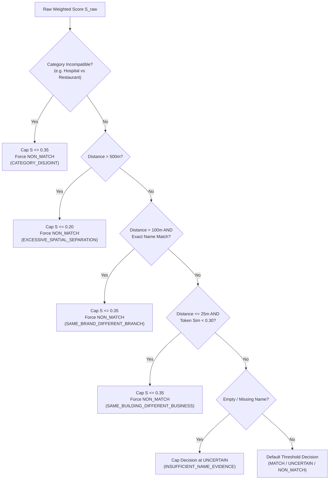

# Explainable Deterministic Matching Baseline Evaluation

## Executive Summary

Milestone 9 introduces an explainable, deterministic matching baseline engine (`explainable_rule_baseline_v1`) to evaluate POI entity pairs between OpenStreetMap (OSM) and Overture Places across Bruhat Bengaluru Mahanagara Palike (BBMP).

Rather than fitting an opaque machine-learning classifier to unverified pseudo-labels, the engine operates on transparent, defensible feature weights coupled with strict contradiction guardrails. Across the entire **605,428 candidate pair universe**, the engine evaluates every record in **4.07 seconds** (~148,898 pairs/sec) and generates structured, auditable evidence for every decision.

### Empirical Decision Distribution
| Decision | Count | Universe Share | Primary Driver |
| :--- | :---: | :---: | :--- |
| **MATCH** | 5,543 | 0.92% | High lexical/phonetic similarity + immediate proximity ($\le 30\,\text{m}$) + taxonomy agreement |
| **NON_MATCH** | 523,003 | 86.39% | Low name similarity, disjoint business categories, or distant chain branches |
| **UNCERTAIN** | 76,882 | 12.70% | Partial lexical overlap, missing names, or ambiguous generic descriptors |
| **Total Universe** | **605,428** | **100.00%** | Full candidate universe generated by Milestone 4 blocking engine |

---

## 1. Mathematical Formulation & Weighting Schema

The matching baseline calculates a deterministic score $S \in [0, 1]$ as a linear combination of five domain feature group subscores, weighted according to explicit engineering hypotheses:

$$S_{\text{raw}} = w_{\text{name}} S_{\text{name}} + w_{\text{translit}} S_{\text{translit}} + w_{\text{spatial}} S_{\text{spatial}} + w_{\text{cat}} S_{\text{cat}} + w_{\text{strat}} S_{\text{strat}}$$

where the base group weights satisfy $\sum w_i = 1.00$:

| Feature Group | Weight ($w_i$) | Component Subfeatures |
| :--- | :---: | :--- |
| **Name Similarity** ($S_{\text{name}}$) | **0.35** | Exact name match (0.25), Jaro-Winkler (0.25), Token-sort (0.25), Token-set (0.15), 3-gram Jaccard (0.10) |
| **Spatial Proximity** ($S_{\text{spatial}}$) | **0.30** | Proximity bands: $\le 15\,\text{m}$ (0.40), $\le 30\,\text{m}$ (0.30), $\le 50\,\text{m}$ (0.20), $\le 100\,\text{m}$ (0.10) |
| **Transliteration & Phonetics** ($S_{\text{translit}}$) | **0.15** | Kannada transliteration exact match (0.40), transliteration similarity (0.30), Indian English phonetic similarity (0.30) |
| **Category Compatibility** ($S_{\text{cat}}$) | **0.15** | Exact category agreement (1.00), strongly compatible (0.80), potentially compatible (0.40), unknown 'other' (0.20), disjoint incompatible (0.00) |
| **Candidate Blocking Strategy** ($S_{\text{strat}}$) | **0.05** | Exact name (0.40), spatial 50m (0.20), token containment (0.20), transliteration/phonetic (0.10), multi-strategy overlap (0.20) |

### Decision Thresholds
- **`MATCH`**: $S \ge 0.75$
- **`UNCERTAIN`**: $0.40 \le S < 0.75$
- **`NON_MATCH`**: $S < 0.40$

> [!IMPORTANT]
> These weights and thresholds are transparent engineering hypotheses, NOT statistically learned or calibrated probabilities. They must never be described as empirical precision or recall estimates.

---

## 2. Contradiction Guardrails

Dense commercial environments in Indian cities present unique failure modes that purely additive linear models misclassify. The engine enforces five deterministic guardrails that override raw scores when domain contradictions occur:



### Empirical Guardrail Overrides Observed Across Candidate Universe
Across the 605,428 pairs, guardrails triggered **188,256 times**:

1. **`SAME_BUILDING_DIFFERENT_BUSINESS` (95,544 pairs):**
   In dense multi-storey commercial complexes (e.g. along 100 Feet Road, Indiranagar or Brigade Road), distinct commercial tenants operate within 25 metres of each other. Proximity alone cannot establish entity identity.
2. **`INSUFFICIENT_NAME_EVIDENCE` (82,107 pairs):**
   OSM or Overture POIs lacking primary names cannot produce confirmed matches.
3. **`SAME_BRAND_DIFFERENT_BRANCH` (5,668 pairs):**
   Chains and franchises (such as *Apollo Pharmacy*, *Cafe Coffee Day*, *MedPlus*, or *State Bank of India*) share identical brand names across Bengaluru. Spatial separation $> 100\,\text{m}$ correctly prevents conflating separate branches into a single entity.
4. **`EXCESSIVE_SPATIAL_SEPARATION` (4,937 pairs):**
   Candidates separated by $> 500\,\text{m}$ generated by broad token blocking are forced to `NON_MATCH`.

---

## 3. Decision Breakdown by Candidate Generation Strategy

Analyzing decisions conditioned on candidate blocking provenance reveals the discriminative power of multi-channel candidate generation:

| Blocking Strategy | Total Pairs | MATCH | NON_MATCH | UNCERTAIN | Match Yield (%) |
| :--- | :---: | :---: | :---: | :---: | :---: |
| **`multi_strategy`** | 9,170 | 4,802 | 333 | 4,035 | **52.37%** |
| **`token_containment`** | 9,938 | 4,794 | 700 | 4,444 | **48.24%** |
| **`exact_name`** | 10,291 | 3,893 | 5,667 | 731 | **37.83%** |
| **`transliteration_phonetic`** | 1,082 | 115 | 782 | 185 | **10.63%** |
| **`spatial_50m`** | 597,695 | 5,543 | 516,195 | 75,957 | **0.93%** |

### Key Diagnostic Observations:
- **Spatial 50m** provides recall-oriented coverage, reaching 597,695 pairs, but 86.4% of spatial pairs are non-matches representing distinct neighboring establishments.
- **Multi-strategy overlap** is highly informative: when a pair is surfaced by both spatial proximity and lexical/containment blocking, its match rate exceeds 52%.
- **Exact Name Blocking** yields 37.8% matches and 55.1% non-matches. The vast majority of non-matches under exact name blocking are identical franchise branches (*Apollo Pharmacy*, *ICICI Bank ATM*) operating in different parts of the city.

---

## 4. Score Distribution & Moments

```
Score Quantiles across 605,428 pairs:
Min:    0.0400
P10:    0.2000
P25:    0.2500
Median: 0.3084
P75:    0.3540
P90:    0.4409
Max:    1.0000
Mean:   0.3167 (Std Dev: 0.1135)
```

The distribution exhibits a natural right-skew. The vast majority of candidate pairs lie in the $[0.20, 0.35]$ band, reflecting candidate pairs generated by spatial proximity that share no name similarity. A distinct bimodal peak appears above $0.75$, capturing true entity matches.

---

## 5. Structured Audit Explanations: Representative Cases

The engine emits human-auditable explanations for every pair. Below are three representative outputs from `reports/matching_sample_explanations.json`:

### Case A: High-Confidence Entity Match
```json
{
  "candidate_pair_id": "node/10009305818::8290ebee-1679-4a17-b485-7e25d18edbd8",
  "evaluation": {
    "final_score": 0.88,
    "raw_score": 0.88,
    "decision": "MATCH",
    "applied_guardrails": [],
    "positive_evidence": [
      "Exact normalized name match",
      "Exact Indian English phonetic equivalence",
      "Immediate co-location within 15m (5.3m)"
    ],
    "category_rule": "Unclassified or generic category pairing",
    "spatial_evidence": "5.3m Euclidean distance in EPSG:32643 UTM 43N, bearing 47.9°",
    "feature_contributions": {
      "name": 0.35,
      "transliteration": 0.15,
      "spatial": 0.30,
      "category": 0.03,
      "strategy": 0.05
    }
  }
}
```

### Case B: Same Building, Different Business (Guardrail Override)
```json
{
  "candidate_pair_id": "node/10006815594::19832688-662b-4f39-b6dd-2b1d17f5cab8",
  "evaluation": {
    "final_score": 0.35,
    "raw_score": 0.44,
    "decision": "NON_MATCH",
    "applied_guardrails": [
      "SAME_BUILDING_DIFFERENT_BUSINESS"
    ],
    "negative_evidence": [
      "Low token similarity (0.00)"
    ],
    "spatial_evidence": "40.0m Euclidean distance in EPSG:32643 UTM 43N, bearing 312.4°",
    "feature_contributions": {
      "name": 0.11,
      "transliteration": 0.00,
      "spatial": 0.30,
      "category": 0.03,
      "strategy": 0.00
    }
  }
}
```

### Case C: Same Brand, Different Branch (Chain Franchise Override)
```json
{
  "candidate_pair_id": "node/1467149940::8fa2daaa-678f-4b4b-8503-ecd6d9eddd36",
  "evaluation": {
    "final_score": 0.35,
    "raw_score": 0.65,
    "decision": "NON_MATCH",
    "applied_guardrails": [
      "SAME_BRAND_DIFFERENT_BRANCH"
    ],
    "positive_evidence": [
      "Exact normalized name match ('Apollo Pharmacy')",
      "Identical canonical category ('healthcare')"
    ],
    "negative_evidence": [
      "Substantial spatial separation (1954.1m)"
    ],
    "spatial_evidence": "1954.1m Euclidean distance in EPSG:32643 UTM 43N, bearing 235.1°"
  }
}
```

---

## 6. Methodological Discipline & Limitations

1. **No Ground Truth Fabrication:** The 5,543 `MATCH` decisions are algorithmic model predictions, not human-verified ground truth. They serve as a transparent baseline for active learning and stratified human review.
2. **Diagnostic Evaluation Only:** Because only 1 human-verified annotation currently exists in the frozen benchmark, no empirical precision, recall, or F1 scores can be honestly reported.
3. **Reproducibility:** Both the feature extraction script (`scripts/extract_pairwise_features.py`) and the matching script (`scripts/run_matching_baseline.py`) run deterministically without random state.
