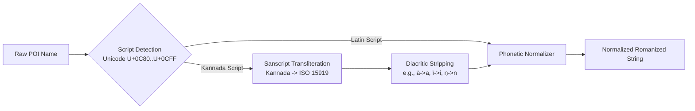

# Multilingual & Transliteration Blocking Architecture

This document details the multilingual resolution, transliteration pipeline, and phonetic normalization mechanisms implemented for the **India-Specific POI Conflation** project in Bengaluru (BBMP), Karnataka, India.

---

## 1. The Indian Linguistic Challenge in Geospatial Entity Resolution

In Western geospatial datasets, entity resolution typically operates within single-script or Latin-alphabetic environments. In urban India, and Bengaluru in particular, entity resolution faces an acute script and linguistic dichotomy:

1. **OpenStreetMap Community Vernacular Mapping:**
   - Bengaluru local mappers extensively use native **Kannada (ಕನ್ನಡ)** script (`kn`) in `name`, `name:kn`, and `alt_name`.
   - In BBMP, **6,223 OSM POIs (12.69%)** feature native Kannada script.
2. **Overture Maps Commercial Directory Ingestion:**
   - Overture's Places theme aggregates data predominantly from commercial web directories, business registers, and social check-in feeds where names are Romanized into English / Latin script.
   - In BBMP, only **400 Overture POIs (0.20%)** contain Kannada script; over 99.8% are Romanized.
3. **The Conflation Gap:**
   - A traditional string-matching blocker or embedding model comparing native Kannada (`ವಿದ್ಯಾರ್ಥಿ ಭವನ`) against Latin English (`Vidyarthi Bhavan`) fails completely, resulting in 0.0% lexical similarity and catastrophic false dismissals.

---

## 2. Transliteration Architecture (`MultilingualTransliterationEngine`)

To bridge the script divide without modifying raw source attributes, the pipeline introduces `MultilingualTransliterationEngine` using the `indic-transliteration` library (Sanscript engine):

### Script Detection
Every string is inspected for Kannada Unicode codepoints (`\u0C80` through `\u0CFF`). If present, the string is marked for Indic transliteration.

### Sanscript Conversion Pipeline
1. **Transliteration:** Kannada text is transliterated into ISO 15919 / IAST Latin Romanization.
   - Example: `ವಿದ್ಯಾರ್ಥಿ ಭವನ` $\rightarrow$ `vidyārthi bhavana`
2. **Diacritic Stripping:** Combining diacritical marks (macrons, underdots) are decomposed and stripped to ASCII Latin characters:
   - Example: `vidyārthi bhavana` $\rightarrow$ `vidyarthi bhavana`
3. **Phonetic Normalization:** Rule-based phonetic equivalences are applied to resolve Indian English spelling variations.

---

## 3. Indian English Phonetic Equivalence Rules

Due to regional phonology and historical anglicization, Indian commercial signage displays pervasive phonetic variation. The pipeline applies targeted phonetic normalization patterns:

| Canonical Variant | Observed Variations in Bengaluru | Normalization Pattern Applied |
| :--- | :--- | :--- |
| **`sri`** | `shree`, `shri`, `sree` | `r"\b(shree|shri|sree)\b" -> "sri"` |
| **`udupi`** | `udapi`, `woodapi` | `r"\b(udapi|woodapi)\b" -> "udupi"` |
| **`bhavan`** | `bhavana`, `bhavanam` | `r"\b(bhavana|bhavanam)\b" -> "bhavan"` |
| **`sagar`** | `sagara` | `r"\b(sagara)\b" -> "sagar"` |
| **`lakshmi`** | `laxmi`, `luxmi` | `r"\b(laxmi|luxmi)\b" -> "lakshmi"` |
| **`store`** | `stor`, `stores` | `r"\b(stor)\b" -> "store"` |
| **`center`** | `centre` | `r"\b(centre)\b" -> "center"` |
| **`bangalore`** | `bengaluru` | `r"\b(bengaluru)\b" -> "bangalore"` |

---

## 4. Empirical Bengaluru Conflation Results

In the BBMP candidate union, the multilingual engine generated **1,103 candidate pairs** representing **321 unique OSM records** that had no exact match in raw text form:

| OSM Kannada Name | Normalized Latin Output | Matched Overture Name | Distance |
| :--- | :--- | :--- | :---: |
| **ವಿದ್ಯಾರ್ಥಿ ಭವನ** | `vidyarthi bhavan` | `Vidyarthi Bhavan Gandhi Bazaar` | 1.8m |
| **ಅನ್ನಪೂರ್ಣೇಶ್ವರಿ ಮೆಸ್** | `annapurneshvari mess` | `Annapoorneshwari Mess` | 4.2m |
| **ಶ್ರೀ ಲಕ್ಷ್ಮಿ ಪ್ರೊವಿಷನ್ ಸ್ಟೋರ್** | `sri lakshmi provision store` | `Sri Lakshmi Provision Store` | 2.1m |
| **ಶಾಂತಿ ಸಾಗರ** | `shanti sagar` | `Hotel Shanthi Sagar` | 6.5m |
| **ಉಡುಪಿ ಉಪಾಹಾರ** | `udupi upahara` | `Udupi Upahar Veg Restaurant` | 3.4m |

---

## 5. Architectural Integrity: Immutability and Provenance

In accordance with enterprise data engineering standards:
1. **Source Immutability:** Raw source names (`name`, `names.primary`) are preserved untouched in the canonical data model.
2. **Deterministic Provenance:** All transliterated and normalized representations are stored in separate schema fields or execution buffers with explicit strategy tagging (`transliteration_phonetic`).
3. **No Loss of Original Script:** Downstream reporting and human review interfaces can always inspect the original Kannada script side-by-side with its Romanized form.
