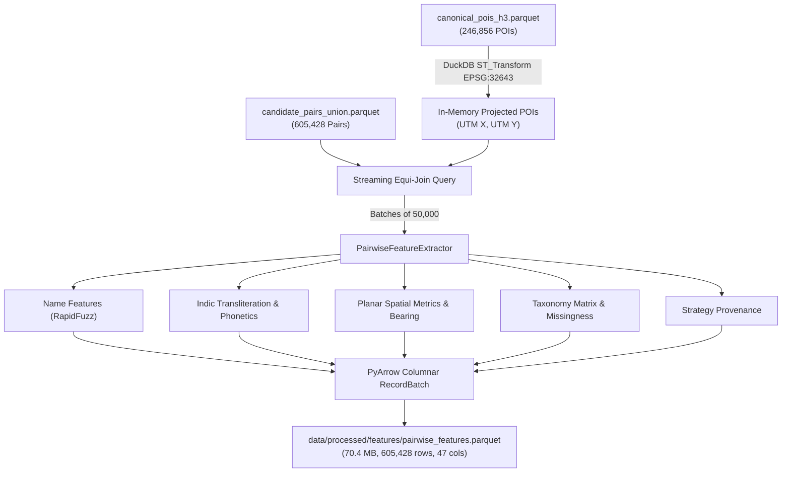

# Pairwise Feature Engineering Architecture & Specification

## Executive Summary

Milestone 9 establishes a modular, reproducible, and memory-bounded pairwise feature engineering pipeline for entity resolution between OpenStreetMap (OSM) and Overture Maps Places in Bruhat Bengaluru Mahanagara Palike (BBMP), Karnataka, India.

Operating on the unified candidate universe of **605,428 candidate pairs** generated across 5 blocking strategies, the pipeline extracts a 44-dimensional feature vector across five key domains:
1. Lexical and name similarity metrics (10 features)
2. Indic language, Kannada script, and Indian English phonetic equivalence (8 features)
3. Projected spatial metrics in EPSG:32643 UTM Zone 43N (12 features)
4. Domain category compatibility matrix (7 features)
5. Candidate generation blocking provenance (7 features)

All features are strictly normalized or explicitly represented with zero null values. The entire dataset is persisted to `data/processed/features/pairwise_features.parquet` (70.4 MB Snappy-compressed) using streaming batch execution that completes in **19.58 seconds** (~30,922 pairs/sec) while strictly adhering to hardware constraints (peak memory: 855.77 MB on an 8 GB Apple Silicon M3).

---

## 1. Feature Schema Specification (v1.0.0)

The feature store adheres to schema version `1.0.0` defined in `src/poi_conflation/features/schema.py`. Every record contains 3 primary identifiers and 44 double-precision floating-point feature values.

### Record Identifiers
| Column | Type | Description |
| :--- | :--- | :--- |
| `candidate_pair_id` | `VARCHAR` | Unique surrogate key formatted as `<osm_source_id>::<ov_source_id>` |
| `osm_source_id` | `VARCHAR` | Canonical source identifier from OpenStreetMap (e.g. `node/10006815594`) |
| `ov_source_id` | `VARCHAR` | Overture Places GERS identifier (e.g. `057dc891-133c-4061-9871-270eb3e311f0`) |

---

### Domain 1: Lexical & Name Similarity (10 Features)

Designed to capture string orthography, token permutations, acronym expansions, and distinctively Indian commercial naming variations.

| Feature Name | Range | Description |
| :--- | :---: | :--- |
| `feat_exact_name_match` | $\{0.0, 1.0\}$ | Binary indicator of exact string equality between normalized names |
| `feat_jaro_winkler` | $[0.0, 1.0]$ | Jaro-Winkler string similarity favoring common prefixes |
| `feat_levenshtein_sim` | $[0.0, 1.0]$ | Normalized Levenshtein edit distance ($1 - \frac{\text{dist}}{\max(\text{len}_1, \text{len}_2)}$) |
| `feat_token_sort_ratio` | $[0.0, 1.0]$ | Token-sorted Levenshtein ratio (invariant to word order permutations) |
| `feat_token_set_ratio` | $[0.0, 1.0]$ | Set-based token intersection similarity (invariant to substring containment) |
| `feat_char_3gram_jaccard` | $[0.0, 1.0]$ | Jaccard similarity over character 3-gram sets ($\frac{\|G_1 \cap G_2\|}{\|G_1 \cup G_2\|}$) |
| `feat_name_length_ratio` | $[0.0, 1.0]$ | Ratio of shorter name length to longer name length ($\frac{\min(L_1, L_2)}{\max(L_1, L_2)}$) |
| `feat_token_count_diff` | $[0.0, \infty)$ | Absolute difference in word token count ($\|\|T_{\text{osm}}\| - \|T_{\text{ov}}\|\|$) |
| `feat_is_generic_name` | $\{0.0, 1.0\}$ | Flag indicating whether either name consists solely of uninformative generic POI terms |
| `feat_is_empty_name` | $\{0.0, 1.0\}$ | Missing-data flag indicating that one or both POIs lack a primary name |

---

### Domain 2: Indic Language, Kannada Transliteration & Phonetics (8 Features)

Accounts for regional linguistic reality in Bengaluru, where establishments are dual-named in native Kannada script (U+0C80–U+0CFF) and Latin script, or exhibit phonetic spelling divergence in English.

| Feature Name | Range | Description |
| :--- | :---: | :--- |
| `feat_osm_has_kannada` | $\{0.0, 1.0\}$ | Kannada Unicode script detected in OSM raw name or dedicated `name_kn` tag |
| `feat_ov_has_kannada` | $\{0.0, 1.0\}$ | Kannada Unicode script detected in Overture raw name or dedicated `name_kn` tag |
| `feat_osm_has_latin` | $\{0.0, 1.0\}$ | Latin ASCII alphabet characters detected in OSM name |
| `feat_ov_has_latin` | $\{0.0, 1.0\}$ | Latin ASCII alphabet characters detected in Overture name |
| `feat_translit_available`| $\{0.0, 1.0\}$ | Indicates that at least one POI possessed native Kannada script transliterated via ISO 15919 |
| `feat_translit_sim` | $[0.0, 1.0]$ | Maximum Jaro-Winkler similarity between transliterated Latin name and counterpart name |
| `feat_translit_exact_match` | $\{0.0, 1.0\}$ | Binary indicator of exact match after Kannada transliteration and accent stripping |
| `feat_indic_phonetic_sim` | $[0.0, 1.0]$ | Token sort similarity after applying Indian commercial phonetic equivalence maps (e.g., *Shree/Sri*, *Laxmi/Lakshmi*, *Bhavana/Bhavan*, *Udapi/Udupi*) |

---

### Domain 3: Projected Metric Spatial Dynamics (12 Features)

Calculated using projected planar coordinates in **EPSG:32643 (UTM Zone 43N)**, avoiding geometric distortions inherent in spherical geographic coordinates.

| Feature Name | Range | Unit / Interpretation |
| :--- | :---: | :--- |
| `feat_distance_meters` | $[0.0, \infty)$ | True Euclidean planar distance in metres ($\sqrt{\Delta X^2 + \Delta Y^2}$) |
| `feat_dist_band_le15m` | $\{0.0, 1.0\}$ | Immediate parcel / entrance co-location band ($\le 15.0\,\text{m}$) |
| `feat_dist_band_le30m` | $\{0.0, 1.0\}$ | Immediate street-front parcel band ($\le 30.0\,\text{m}$) |
| `feat_dist_band_le50m` | $\{0.0, 1.0\}$ | Primary spatial blocking threshold band ($\le 50.0\,\text{m}$) |
| `feat_dist_band_le100m` | $\{0.0, 1.0\}$ | Extended urban block proximity band ($\le 100.0\,\text{m}$) |
| `feat_log_distance` | $[0.0, \infty)$ | Log-transformed distance metric ($\ln(1 + \text{dist})$) |
| `feat_delta_x` | $(-\infty, \infty)$ | Easting displacement: $X_{\text{ov}} - X_{\text{osm}}$ in metres |
| `feat_delta_y` | $(-\infty, \infty)$ | Northing displacement: $Y_{\text{ov}} - Y_{\text{osm}}$ in metres |
| `feat_abs_delta_x` | $[0.0, \infty)$ | Absolute Easting offset: $\|X_{\text{ov}} - X_{\text{osm}}\|$ |
| `feat_abs_delta_y` | $[0.0, \infty)$ | Absolute Northing offset: $\|Y_{\text{ov}} - Y_{\text{osm}}\|$ |
| `feat_bearing_deg` | $[0.0, 360.0)$ | Clockwise directional heading from OSM to Overture ($0^\circ = \text{North}, 90^\circ = \text{East}$); $-1.0$ if missing |
| `feat_missing_coords` | $\{0.0, 1.0\}$ | Quality indicator flagging missing or corrupt coordinates |

---

### Domain 4: Category Compatibility Matrix (7 Features)

Encodes canonical taxonomy alignment based on the 10-class BBMP POI ontology.

| Feature Name | Range | Definition |
| :--- | :---: | :--- |
| `feat_exact_category_match` | $\{0.0, 1.0\}$ | Non-'other' identical canonical categories |
| `feat_category_strongly_compat` | $\{0.0, 1.0\}$ | Identical categories or identical fallback classifications |
| `feat_category_potentially_compat` | $\{0.0, 1.0\}$ | Plausible commercial overlap (e.g. `sustenance` & `hospitality`, `retail` & `healthcare`) |
| `feat_category_unknown_compat` | $\{0.0, 1.0\}$ | Generic or unclassified pairing where one or both entities are `other` |
| `feat_category_incompatible` | $\{0.0, 1.0\}$ | Disjoint commercial domains (e.g. `healthcare` vs `sustenance`, `financial` vs `education`) |
| `feat_osm_category_missing` | $\{0.0, 1.0\}$ | OSM entity lacks granular classification (`other` or null) |
| `feat_ov_category_missing` | $\{0.0, 1.0\}$ | Overture entity lacks granular classification (`other` or null) |

---

### Domain 5: Candidate Blocking Provenance (7 Features)

Captures the recall-oriented candidate generation channels that surfaced the pair.

| Feature Name | Range | Description |
| :--- | :---: | :--- |
| `feat_strat_spatial_50m` | $\{0.0, 1.0\}$ | Surfaced via H3 spatial indexing within 50 metres |
| `feat_strat_token_containment` | $\{0.0, 1.0\}$ | Surfaced via distinctive token containment within 100 metres |
| `feat_strat_exact_name` | $\{0.0, 1.0\}$ | Surfaced via exact normalized name blocking across entire BBMP |
| `feat_strat_translit` | $\{0.0, 1.0\}$ | Surfaced via Kannada script transliteration matching |
| `feat_strat_phonetic` | $\{0.0, 1.0\}$ | Surfaced via Indian commercial phonetic equivalence index |
| `feat_multi_strategy_overlap` | $\{0.0, 1.0\}$ | Surfaced independently by more than one blocking channel |
| `feat_strategy_count` | $[1.0, 5.0]$ | Total count of distinct blocking strategies that generated this pair |

---

## 2. Pipeline Architecture & Performance

The feature extraction pipeline (`scripts/extract_pairwise_features.py`) connects to DuckDB to perform an in-memory spatial projection of the 246,856 canonical POIs into EPSG:32643 UTM 43N coordinates.

Candidate pairs are joined with projected geometries and streamed in 50,000-pair batches into `pyarrow.RecordBatch` writers with Snappy compression.

### Empirical Execution Benchmarks
- **Total Pairs Processed:** 605,428
- **Total Feature Columns:** 44 (plus 3 string ID keys)
- **Execution Time:** 19.58 seconds
- **Throughput:** 30,922.6 pairs/sec
- **Peak Memory Usage:** 855.77 MB RSS (well within the 8 GB unified memory budget)
- **Output File Size:** 70.4 MB (snappy-compressed Parquet)
- **Missing Value Count:** Exactly 0 across all 44 feature fields (explicit indicators used for missingness).
