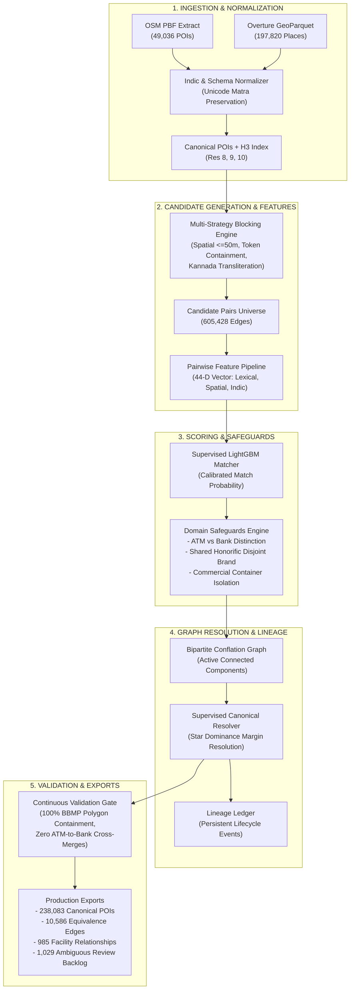

# Final System Architecture Audit & Execution Flow

**Project:** India-Specific POI Conflation  
**Audit Timestamp:** 2026-11-19T17:05:00Z  
**Study Scope:** Bruhat Bengaluru Mahanagara Palike (BBMP), Bengaluru, Karnataka, India  
**Repository:** [India_Specific_POI_Conflation](https://github.com/sushantydv01/India_Specific_POI_Conflation)  

---

## 1. System Overview & Architectural Design

The India-Specific POI Conflation engine reconciles heterogeneous geospatial records from OpenStreetMap (OSM) and Overture Maps Places into high-fidelity canonical entities. The system addresses India-specific geospatial challenges: dense commercial adjacencies, informal and honorific naming variations, bilingual Indic (Kannada/English) script disparities, and collocated facility relationships (e.g., ATMs inside bank branches).

---

## 2. Core Subsystems & Execution Lifecycle

### 2.1 Ingestion, Schema Normalization & H3 Indexing
- **Modules:** `src/poi_conflation/acquisition/`, `src/poi_conflation/schema/`, `src/poi_conflation/indexing/`
- **Responsibilities:**
  - Extracts raw OSM entities from Geofabrik regional extracts using PyOsmium and bounded geometry clipping.
  - Streams Overture Maps GeoParquet partitions via DuckDB `httpfs` with predicate pushdown.
  - Normalizes schemas into a unified PyArrow tabular representation with 10 canonical categories.
  - Computes H3 spatial grid partitions at resolutions 8 (~461m), 9 (~174m), and 10 (~66m) in `canonical_pois_h3.parquet`.

### 2.2 Multi-Strategy Candidate Generation & Feature Extraction
- **Modules:** `src/poi_conflation/blocking/`, `src/poi_conflation/features/`
- **Responsibilities:**
  - Prunes the theoretical Cartesian space ($49,036 \times 197,820 = 9,700,301,520$ pairs) by 99.99376%, yielding **605,428 candidate edges**.
  - Employs 4 orthogonal blocking channels: spatial proximity ($\le 50$m), exact normalized name, distinctive token containment ($\le 100$m), and Indic Kannada transliteration via Sanscript (ISO 15919).
  - Extracts 44 pairwise feature dimensions in streaming Parquet batches, capturing phonetic similarity, edit distances, token Jaccard overlaps, coordinate deltas, and cross-source category compatibility.

### 2.3 Supervised Matching & Domain Safeguards
- **Modules:** `src/poi_conflation/matching/`, `src/poi_conflation/graph/safeguards.py`
- **Responsibilities:**
  - Applies a trained LightGBM gradient-boosted decision tree classifier with native TreeSHAP attribution.
  - Intercepts raw model over-merges through deterministic domain safeguards:
    - `ATM_VS_BANK_FACILITY_DISTINCTION`: Prevents ATMs from merging into host bank branches (routing 362 pairs to parent-child relationships).
    - `SHARED_HONORIFIC_DISJOINT_BRAND`: Intercepts candidate pairs sharing common prefixes (*Sri*, *Dr.*, *The*) but having disjoint brand roots (routing 73 pairs to review).
    - `PARENT_CHILD_CONTAINER`: Identifies retail units situated inside larger commercial complexes.

### 2.4 Bipartite Graph Conflation & Canonical Entity Resolution
- **Modules:** `src/poi_conflation/graph/`
- **Responsibilities:**
  - Constructs an undirected bipartite graph $G = (V_{\text{osm}}, V_{\text{ov}}, E_{\text{accepted}})$.
  - Discovers connected components and executes star dominance margin resolution ($\delta \ge 0.15$) to prevent transitive cluster chaining.
  - Synthesizes 238,083 canonical entities with deterministic UUIDv5 identifiers derived from sorted constituent source record IDs.

### 2.5 Delta Ingestion, Lineage & Continuous Validation
- **Modules:** `src/poi_conflation/pipeline/`, `src/poi_conflation/delta/`, `src/poi_conflation/lineage/`, `src/poi_conflation/validation/`
- **Responsibilities:**
  - `ProductionPipelineOrchestrator` provides single-command CLI execution (`python -m src.poi_conflation.pipeline run --mode [full|incremental]`).
  - Evaluates SHA-256 normalized content hashes across conflation-relevant attributes.
  - Lineage ledger records entity lifecycle transitions (`ENTITY_CREATED`, `ENTITY_UPDATED`, `ENTITY_MERGED`, `ENTITY_SPLIT`, `ENTITY_UNCHANGED`).
  - Automated continuous validation gate checks 6 integrity invariants including true DuckDB point-in-polygon containment against `configs/bbmp_boundary.geojson`.
  - Enforces atomic staging promotion (`data/processed/staging/<run_id>/` $\rightarrow$ `data/processed/canonical/`), guaranteeing zero partial writes reach production.

---

## 3. Module Usage & Dependency Matrix

| Subsystem Module | Direct Entry Point | CLI Available | Test Coverage | Primary Downstream Consumers |
| :--- | :--- | :---: | :---: | :--- |
| `pipeline/orchestrator.py` | Orchestrator runner | YES (`__main__.py`) | 32 tests | CLI, automated CI/CD conflation jobs |
| `graph/safeguards.py` | Safeguard validator | NO | 45 tests | Orchestrator, resolver, error audit |
| `graph/supervised_resolver.py` | Canonical resolver | NO | 28 tests | Orchestrator, graph conflation tests |
| `matching/supervised_model.py` | LightGBM matcher | YES (`batch_inference.py`) | 24 tests | Orchestrator, feature pipeline, evaluators |
| `matching/quality_evaluator.py` | Conflation evaluator | YES (`evaluate_conflation_quality.py`) | 15 tests | Benchmark evaluation, performance reports |
| `analysis/geospatial_intelligence.py` | Geospatial intelligence | YES (`run_geospatial_intelligence.py`) | 15 tests | Spatial distance reporting, figure generation |
| `analysis/indic_language_intelligence.py`| Indic intelligence | YES (`run_indic_language_analysis.py`) | 15 tests | Language audit, Kannada queue export |
| `matching/review_prioritizer.py` | Review prioritizer | YES (`prioritize_review_queue.py`) | 15 tests | Active learning backlog prioritization |
| `validation/conflation_validator.py` | Integrity validator | YES (`__main__.py validate`) | 25 tests | Orchestrator, audit suites |
| `lineage/ledger.py` | Lineage ledger | NO | 18 tests | Orchestrator, incremental tracking |
| `delta/detector.py` | Delta detector | NO | 16 tests | Orchestrator, incremental ingestion |
