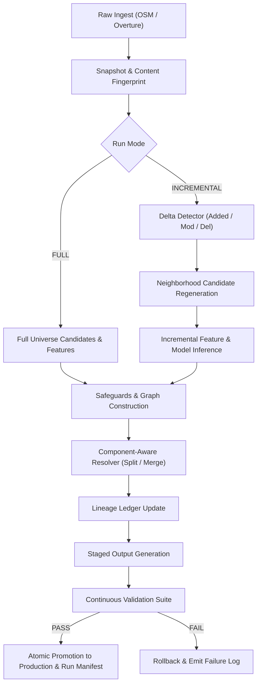

# Milestone 17 — Architecture Assessment & Technical Design

**Project:** India-Specific POI Conflation  
**Scope:** BBMP, Bengaluru, Karnataka, India  
**Date:** 2026-11-19  
**Author:** Sushant Yadav  

---

## 1. Executive Summary & Objective

Milestone 17 transitions the India-Specific POI Conflation system from isolated milestone scripts into a production-grade, incremental, and continuously validated conflation pipeline. The primary architectural challenge is moving from a monolithic batch execution model across the entire 246,856 source POIs and 605,428 candidate edges to an incremental delta engine that safely isolates affected graph components, maintains canonical ID stability for unaffected entities, explicitly records entity lineage across component merges and splits, and executes continuous integrity validation after every run.

This assessment inspects the existing architecture and defines the design contracts required for Milestone 17.

---

## 2. Technical Audit & Architecture Assessment

### Question 1: What is the current full-run execution path?

Currently, end-to-end conflation requires executing a sequence of independent scripts:
1. **Source Ingestion & Boundary Slicing:**
   - `scripts/acquire_boundary.py` $\rightarrow$ `configs/bbmp_boundary.geojson`
   - `scripts/acquire_osm.py` $\rightarrow$ `data/raw/osm/bengaluru_osm_pois.parquet` (49,036 records)
   - `scripts/acquire_overture.py` $\rightarrow$ `data/raw/overture/bengaluru_overture_places.parquet` (197,820 records)
2. **Canonical Transformation & Spatial Indexing:**
   - `scripts/transform_canonical.py` $\rightarrow$ `data/processed/canonical_pois.parquet` (246,856 records)
   - `scripts/run_h3_indexing.py` $\rightarrow$ `data/processed/canonical_pois_h3.parquet` (H3 resolutions 8, 9, 10)
3. **Multi-Strategy Candidate Blocking:**
   - `scripts/run_candidate_generation.py` $\rightarrow$ `data/processed/candidate_pairs/candidate_pairs_union.parquet` (605,428 pairs)
4. **Pairwise Feature Extraction:**
   - `scripts/extract_pairwise_features.py` $\rightarrow$ `data/processed/features/pairwise_features.parquet` (44 features)
5. **Supervised Model Inference:**
   - `scripts/run_batch_inference.py` $\rightarrow$ `data/processed/predictions/supervised_predictions_universe.parquet` (LightGBM probabilities)
6. **Graph Conflation & Canonical Entity Resolution:**
   - `scripts/run_graph_conflation_pipeline.py` $\rightarrow$ `data/processed/canonical/`:
     - `canonical_pois.parquet` (238,083 entities)
     - `canonical_pois.geojson` (86 MB GeoJSON)
     - `conflation_edges.parquet` (605,428 evaluated edges)
     - `poi_relationships.parquet` (985 non-equivalence relationships)
     - `unresolved_pairs.parquet` (2,842 review candidate pairs)

*Architectural Gap:* No single controlled entry point orchestrates these stages; intermediate data handoffs rely on static filesystem paths rather than a managed pipeline context with atomic staging.

---

### Question 2: Which modules are deterministic?

All core algorithmic modules are mathematically deterministic:
- **Spatial Proximity & Grid Equi-Joins:** Metric grid binning ($200\text{m} \times 200\text{m}$) in UTM Zone 43N.
- **Lexical & Transliteration Normalization:** RapidFuzz scorers and `indic-transliteration` Sanscript converters.
- **Feature Extraction:** 44-dimensional feature vector extraction given fixed input pairs.
- **Model Inference:** LightGBM inference on frozen estimator weights (`models/supervised_poi_matcher_v1.joblib`).
- **Domain Safeguards:** Rule-based boolean predicate checks (`ATM_VS_BANK_FACILITY_DISTINCTION`, `PARENT_CHILD_CONTAINER`, `SAME_BRAND_DIFFERENT_BRANCH`, etc.).
- **Graph Component Discovery:** Depth-First Search / Breadth-First Search traversal over sorted adjacency lists.
- **Canonical ID Generation:** UUIDv5 generation via `generate_canonical_uuid(osm_ids, ov_ids)` using sorted constituent lists.
- **Canonical Attribute Fusion:** Deterministic precedence rules for names, coordinates, and categories.

*Verification:* Verified in M16.1 rerun where 238,083 canonical entities matched with 0 ID differences and 0 decision differences.

---

### Question 3: Which outputs are source-dependent?

Every output artifact is directly downstream of the source POI inputs:
- If a source POI's coordinates change: its H3 cell, candidate blocking pairs, pairwise spatial distance features, model prediction, and component membership are affected.
- If a source POI's name changes: its lexical features, blocking containment, and safeguard triggers are affected.
- If a source POI is added or deleted: local candidate edges, component topology, and canonical entities are created, merged, split, or retired.

---

### Question 4: How are source records identified?

Source records are identified by their primary source system keys:
- **OpenStreetMap:** `osm_id` formatted with OSM element type prefix (e.g., `node/12345678`, `way/98765432`). In canonical tables, provider is stored as `poi_source = 'OSM'` and ID as `source_id`.
- **Overture Maps:** `ov_id` formatted as a hexadecimal UUID string (e.g., `08f2...`). In canonical tables, provider is stored as `poi_source = 'OVERTURE'` and ID as `source_id`.
- **Pre-conflation Source Identifier:** In `canonical_pois_h3.parquet`, each source record has a `canonical_poi_id` generated via `uuid5(NAMESPACE, f"{source}:{source_id}")`.

---

### Question 5: How are canonical IDs generated?

Post-conflation canonical entity IDs are generated deterministically using RFC 4122 UUIDv5:
```python
CANONICAL_ENTITY_NAMESPACE = uuid.UUID("9a8bf37f-af65-5399-9fab-35bcd714c702")

def generate_canonical_uuid(osm_ids: List[str], ov_ids: List[str]) -> str:
    key = f"osm:{','.join(sorted(osm_ids))}|ov:{','.join(sorted(ov_ids))}"
    return str(uuid.uuid5(CANONICAL_ENTITY_NAMESPACE, key))
```
- **Equivalence Entities (`RESOLVED_EQUIVALENCE`):** Generated from sorted OSM ID(s) and Overture ID(s) (e.g., `osm:node/123|ov:08f2...`).
- **Disambiguated Singletons (`DISAMBIGUATED_SINGLETON`):** Generated from a single source ID (e.g., `osm:node/123|ov:` or `osm:|ov:08f2...`).
- **Ambiguous Entities (`UNRESOLVED_AMBIGUOUS`):** Also generated as single-source singleton representations preserving node identity without merging.

*Key Invariant:* Because UUIDv5 is pure cryptographic hashing over sorted source IDs, if an entity's constituent source membership is unchanged, its `canonical_entity_id` is 100% stable across runs.

---

### Question 6: What happens when a source record disappears?

When a source record is deleted:
1. **If it was a Singleton (`DISAMBIGUATED_SINGLETON`):** Its canonical entity ceases to exist. It must be retired (`ENTITY_RETIRED`) in the lineage ledger and removed from active canonical exports.
2. **If it was part of an Equivalence (`RESOLVED_EQUIVALENCE`):**
   - The equivalence cluster dissolves.
   - The remaining partner node reverts to a singleton representation.
   - The old merged canonical ID is retired (`ENTITY_SPLIT` / `ENTITY_RETIRED`), and the remaining node assumes its canonical singleton ID (`ENTITY_CREATED` or restored).
3. **Candidate Edges:** Obsolete candidate edges referencing the deleted source ID must be removed.
4. **Relationships:** Any parent-child or facility relationships referencing the deleted record must be excised.

---

### Question 7: Can the current resolver safely process a subset of changed edges?

**No, not without isolating full connected components.**
- The current implementation of `SupervisedCanonicalResolver.resolve_graph` takes all nodes and all clusters, validating complete source-record accounting across the entire graph.
- If only a raw subset of changed edges were fed to the resolver without their adjacent component context, transitive relationships, competing candidate edges, and star dominance margins ($\Delta s \ge 0.15$) would be evaluated on incomplete local subgraphs, leading to erroneous merges or missed safeguards.
- **Solution:** Incremental resolution must be component-aware. Because connected components in a conflation graph are mutually disjoint equivalence partitions, any component whose nodes and incident edges have NOT changed is mathematically guaranteed to produce an identical canonical resolution. Therefore:
  $$\text{Affected Components} = \{ C \in \mathcal{C} \mid V(C) \cap (V_{\text{added}} \cup V_{\text{modified}} \cup V_{\text{deleted}} \cup V_{\text{re-evaluated}}) \neq \emptyset \}$$
  Unaffected components are copied directly; only affected components are re-resolved.

---

### Question 8: What data must be retained to support incremental processing?

To support incremental processing without full re-extraction:
1. **Source Snapshot Manifest & Content Fingerprints:** A ledger of source snapshots, record counts, and SHA-256 content hashes of conflation-relevant attributes (`name`, `coordinates`, `category`, `brand`, `address`) to detect `ADDED`, `MODIFIED`, `DELETED`, and `UNCHANGED` records.
2. **Active Candidate Edge Store:** Current candidate pairs, features, and model scores, allowing reuse of unaffected edges.
3. **Graph Component Membership Index:** Mapping each source record (`osm_id`, `ov_id`) to its current component ID and canonical entity ID.
4. **Lineage Ledger:** Historical record of canonical entity state transitions (`ENTITY_CREATED`, `ENTITY_UPDATED`, `ENTITY_MERGED`, `ENTITY_SPLIT`, `ENTITY_RETIRED`, `ENTITY_UNCHANGED`).
5. **Previous Canonical Datasets & Relationships:** Retained in versioned run storage for change detection and rollback.

---

### Question 9: Which existing tests protect canonical ID stability?

- `tests/test_conflation_audit_m16_1.py`:
  - `test_source_record_accounting_and_provenance`: Verifies 238,083 canonical entities, zero collisions, zero duplicates.
  - `test_canonical_export_integrity`: Validates schema, coordinate bounding box, and non-null identifiers.
- `tests/test_supervised_graph_conflation_m16.py`:
  - `test_canonical_resolution_accounting`: Verifies 100% source-record preservation.
  - `test_bipartite_conflation_graph_components`: Verifies deterministic component extraction.
- `tests/test_canonical_resolution.py`:
  - `test_generate_canonical_uuid_determinism`: Asserts that `generate_canonical_uuid` is invariant to input order.

---

### Question 10: What architectural changes are necessary?

1. **Unified Pipeline Orchestrator (`src/poi_conflation/pipeline/`):**
   - Controlled CLI entry point: `python -m src.poi_conflation.pipeline run --mode [full|incremental]`.
   - Pipeline stages: Source Validation $\rightarrow$ Normalization $\rightarrow$ Delta Detection $\rightarrow$ Candidate Gen $\rightarrow$ Feature Extraction $\rightarrow$ Model Inference $\rightarrow$ Safeguards $\rightarrow$ Graph Resolution $\rightarrow$ Canonical Export $\rightarrow$ Continuous Validation $\rightarrow$ Manifest Generation.
   - Atomic staging directory: write to `data/processed/staging_<run_id>/` and promote atomically to production on validation success.
2. **Snapshot & Delta Detection Engine (`src/poi_conflation/delta/`):**
   - Normalized content fingerprinting across relevant attributes.
   - Delta classification: `ADDED`, `MODIFIED`, `DELETED`, `UNCHANGED`.
3. **Incremental Candidate & Graph Engine:**
   - Spatial neighborhood candidate regeneration for added/modified records.
   - Component-aware graph updater handling merges and splits.
4. **Persistent Lineage Ledger (`src/poi_conflation/lineage/`):**
   - Full audit trail of entity lifecycle transitions.
5. **Continuous Validation Suite (`src/poi_conflation/validation/conflation_validator.py`):**
   - Automated post-execution validator executing source, candidate, graph, canonical, relationship, and incremental integrity gates.
6. **Shared-Honorific Safeguard Evaluation:**
   - Investigate the ~242 pairs with shared honorific prefixes and evaluate `SHARED_HONORIFIC_DISJOINT_BRAND`.

---

## 3. Migration and Execution Strategy



This design guarantees that incremental updates are semantically equivalent to full rebuilds while preserving unaffected canonical entities and providing a complete audit trail.
